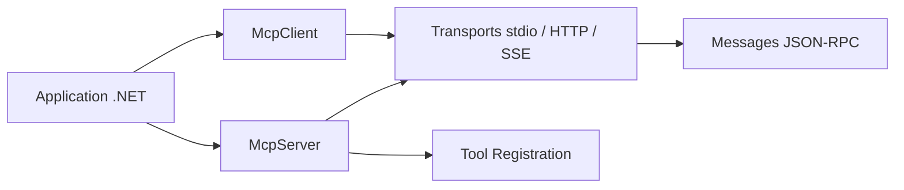

# modelcontextprotocol/csharp-sdk

> Official C# SDK for the MCP protocol, to write clients and servers in .NET applications.

## The problem
Exposing tools to an LLM or consuming them from .NET means implementing JSON-RPC, the transports and the protocol types yourself.

## What it actually does
Six NuGet packages: `ModelContextProtocol.Core` (low-level client and server), `ModelContextProtocol` (hosting and dependency injection), `…AspNetCore` (HTTP servers), plus Apps, Skills and Tasks extensions. Supports stdio and HTTP/SSE, attribute-based tool registration and the Identity Assertion Authorization Grant flow.

## How it is wired


## Trying it
```bash
# Aucune commande dans le README fourni :
# voir le Getting Started de la documentation conceptuelle
```

## Cost and gotchas
Free. The license is present but not identified by GitHub: check before commercial use. 212 open issues.

## What it is not
Not a ready-to-use MCP server nor an agent framework: it is a protocol layer.

## Alternatives
- modelcontextprotocol/java-sdk: Java equivalent, same organization.

## For you
Ignore: only useful if your stack is .NET; in Python, the matching official SDK will be more direct.
