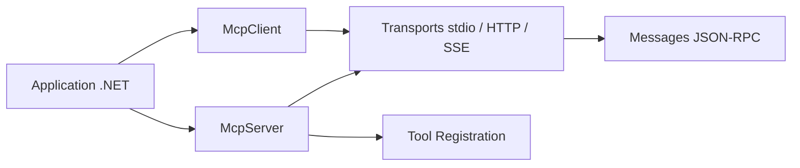

# modelcontextprotocol/csharp-sdk

> SDK C# officiel du protocole MCP pour écrire clients et serveurs dans des applications .NET.

## Le problème
Exposer des outils à un LLM ou en consommer côté .NET suppose d'implémenter soi-même JSON-RPC, les transports et les types du protocole.

## Ce que ça fait vraiment
Six paquets NuGet : `ModelContextProtocol.Core` (client et serveur bas niveau), `ModelContextProtocol` (hébergement et injection de dépendances), `…AspNetCore` (serveurs HTTP), plus extensions Apps, Skills et Tasks. Prend en charge stdio et HTTP/SSE, l'enregistrement d'outils par attributs et le flux Identity Assertion Authorization Grant.

## Comment c'est branché


## Essayer
```bash
# Aucune commande dans le README fourni :
# voir le Getting Started de la documentation conceptuelle
```

## Coût et pièges
Gratuit. La licence est présente mais non identifiée par GitHub : à vérifier avant usage commercial. 212 issues ouvertes.

## Ce que ce n'est pas
Pas un serveur MCP prêt à l'emploi ni un framework d'agents : c'est une couche protocole.

## Alternatives
- modelcontextprotocol/java-sdk : équivalent Java, même organisation.

## Pour toi
À ignorer : utile uniquement si ton stack est .NET ; en Python, le SDK officiel correspondant sera plus direct.

