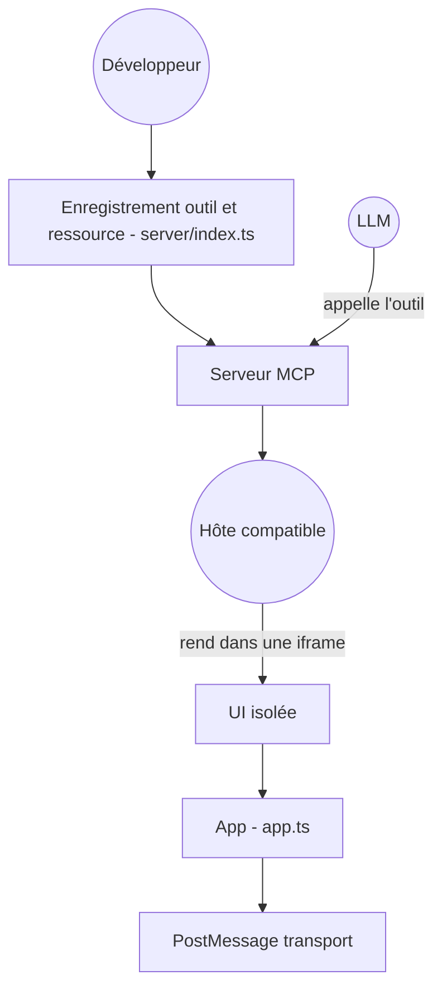

# modelcontextprotocol/ext-apps

> TypeScript SDK for an MCP tool to display an interactive interface in the chat, for MCP server authors.

## The problem
MCP tools return text and structured data. As soon as you need a chart, a form or a video player, there is no standard way to display it in the conversation.

## What it actually does
The tool declares a `ui://` resource containing its HTML. When the model calls the tool, the compatible host loads the resource and displays it in a sandboxed iframe. The interface receives data through notifications and can call other tools back via the host. The SDK offers four sub-packages: views, React hooks, host bridge, server-side registration.

## How it is wired


## Trying it
```bash
npm install -S @modelcontextprotocol/ext-apps \
  @modelcontextprotocol/client@^2.0.0 \
  zod@^4.2.0

git clone https://github.com/modelcontextprotocol/ext-apps.git
cd ext-apps
npm install
npm start
```
Then open http://localhost:8080/.

## Cost and gotchas
Free. Node.js 20+ and the MCP packages in version `^2.0.0` are required. The license is present but GitHub does not identify it: check before use. 225 open issues.

## What it is not
It is not a chat client: the repository does not provide a supported host, only the `basic-host` example. Rendering depends on the host (Claude, ChatGPT, etc.) which must implement the specification.

## Alternatives
- MCP-UI client SDK: a complete framework already used by a few hosts, if you are building the client side.

## For you
Adopt if you expose MCP tools to an agent and want to put dashboards or forms in them: the protocol is stable (spec 2026-01-26) and the examples already cover heatmap and segmentation.
