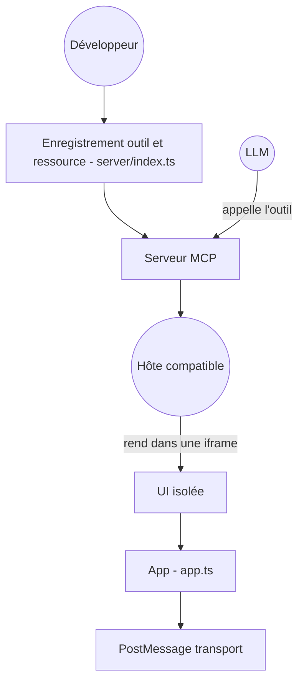

# modelcontextprotocol/ext-apps

> SDK TypeScript pour qu'un outil MCP affiche une interface interactive dans le chat, pour les auteurs de serveurs MCP.

## Le problème
Les outils MCP renvoient du texte et des données structurées. Dès qu'il faut un graphique, un formulaire ou un lecteur vidéo, rien de standard n'existe pour l'afficher dans la conversation.

## Ce que ça fait vraiment
L'outil déclare une ressource `ui://` contenant son HTML. Quand le modèle appelle l'outil, l'hôte compatible charge la ressource et l'affiche dans une iframe isolée. L'interface reçoit les données par notifications et peut rappeler d'autres outils via l'hôte. Le SDK propose quatre sous-paquets : vues, hooks React, pont hôte, enregistrement côté serveur.

## Comment c'est branché


## Essayer
```bash
npm install -S @modelcontextprotocol/ext-apps \
  @modelcontextprotocol/client@^2.0.0 \
  zod@^4.2.0

git clone https://github.com/modelcontextprotocol/ext-apps.git
cd ext-apps
npm install
npm start
```
Puis ouvrir http://localhost:8080/.

## Coût et pièges
Gratuit. Il faut Node.js 20+ et les paquets MCP en version `^2.0.0`. La licence est présente mais GitHub ne l'identifie pas : à vérifier avant usage. 225 issues ouvertes.

## Ce que ce n'est pas
Ce n'est pas un client de chat : le dépôt ne fournit pas d'hôte supporté, seulement l'exemple `basic-host`. Le rendu dépend de l'hôte (Claude, ChatGPT, etc.) qui doit implémenter la spécification.

## Alternatives
- MCP-UI client SDK : cadre complet déjà utilisé par quelques hôtes, si tu construis le côté client.

## Pour toi
À adopter si tu exposes des outils MCP à un agent et veux y mettre des tableaux de bord ou formulaires : le protocole est stable (spec 2026-01-26) et les exemples couvrent déjà heatmap et segmentation.

