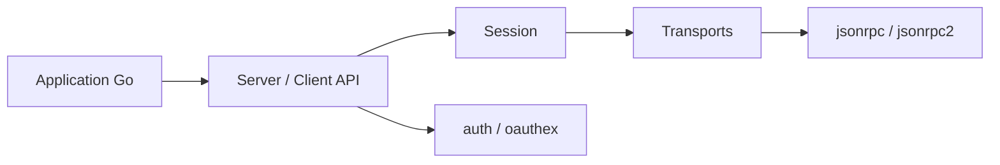

# modelcontextprotocol/go-sdk

> Official Go SDK for the Model Context Protocol, for writing MCP servers and clients.

## The problem
Exposing tools to an LLM, or consuming them, in Go, without reimplementing the MCP protocol.

## What it actually does
The `mcp` package provides `Server`, `Client`, sessions, tools, resources, prompts and transports (stdio, command, SSE, streamable HTTP). `jsonrpc` is for custom transports; `auth` and `oauthex` handle OAuth and MCP extensions. Conformance tests cover several versions of the specification, including 2026-07-28 since v1.7.0.

## How it is wired

## Trying it
The README gives no install command. It shows a Go example: `mcp.NewServer(...)`, `mcp.AddTool(...)`, then `server.Run(ctx, &mcp.StdioTransport{})`.

## Cost and gotchas
A license is present but not identified by GitHub. Roots, sampling and logging have been deprecated since spec 2026-07-28. Client-side OAuth remains experimental on some versions.

## What it is not
Not a ready-to-use MCP server: it is a library. It is not the Python SDK.

## Alternatives
The README names no alternatives.

## For you
Worth watching: keep it in mind if you write MCP tools in Go; otherwise an SDK in another language is enough.
