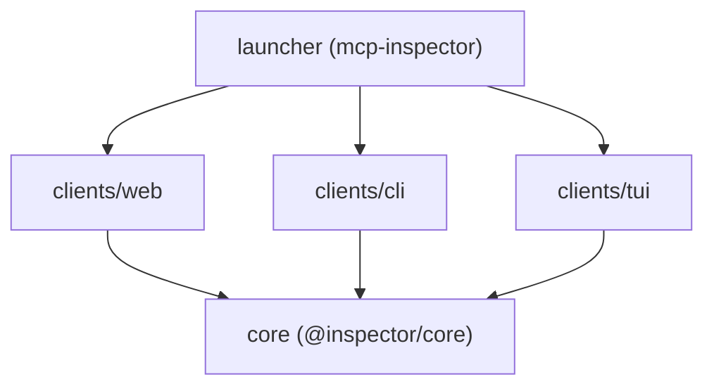

# modelcontextprotocol/inspector

> Developer tool for inspecting and testing MCP servers, via web, CLI or terminal.

## The problem
Debugging an MCP server by hand (tools, resources, OAuth) is tedious.

## What it actually does
A single package provides four interfaces: web application (Vite, React, Node backend), a CLI scriptable for CI, an Ink TUI, and `mcpdo` (experimental, named connection with a local daemon). Handles OAuth and secrets, stored in the system keychain, otherwise in `~/.mcp-inspector/secrets.json`. The v2 line lives on `v2/main`.

## How it is wired


## Trying it
```bash
npx @modelcontextprotocol/inspector
npx @modelcontextprotocol/inspector --cli
npx @modelcontextprotocol/inspector --tui
npx -p @modelcontextprotocol/inspector mcpdo --help
```

## Cost and gotchas
Free. Node ^22.23.4, ^24.22.1 or >=26.12.1. Without a keychain, secrets may be written in plain text to a file.

## What it is not
Not a chat client nor an MCP server. The move from v1 to v2 breaks some CLI options. License present but unidentified.

## Alternatives
None named in the README.

## For you
Adopt: the MCP project's own repository, essential if you build or test MCP servers; watch out for how secrets are stored.
