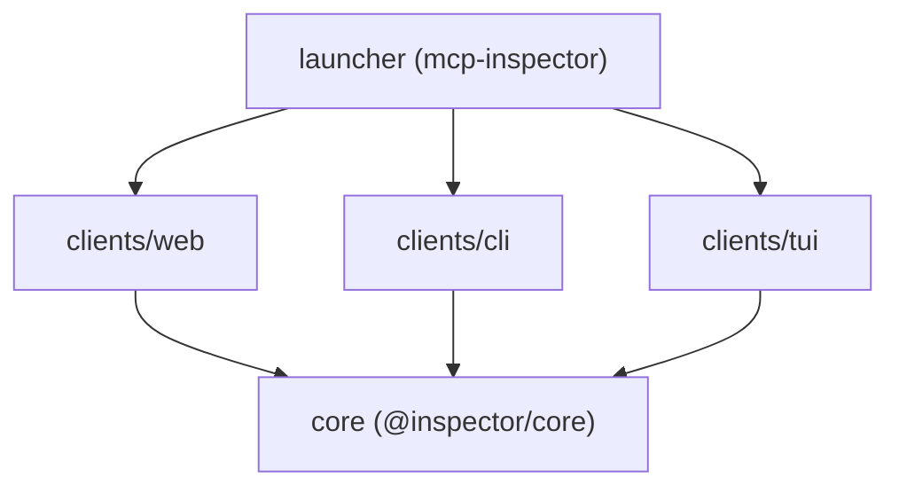

# modelcontextprotocol/inspector

> Outil de développement pour inspecter et tester des serveurs MCP, en web, CLI ou terminal.

## Le problème
Déboguer un serveur MCP à la main (outils, ressources, OAuth) est fastidieux.

## Ce que ça fait vraiment
Un seul paquet donne quatre interfaces : application web (Vite, React, backend Node), CLI scriptable pour la CI, TUI Ink et `mcpdo` (expérimental, connexion nommée avec démon local). Gère OAuth et les secrets, stockés dans le trousseau du système sinon dans `~/.mcp-inspector/secrets.json`. Ligne v2 sur `v2/main`.

## Comment c'est branché


## Essayer
```bash
npx @modelcontextprotocol/inspector
npx @modelcontextprotocol/inspector --cli
npx @modelcontextprotocol/inspector --tui
npx -p @modelcontextprotocol/inspector mcpdo --help
```

## Coût et pièges
Gratuit. Node ^22.23.4, ^24.22.1 ou >=26.12.1. Sans trousseau, les secrets peuvent être écrits en clair dans un fichier.

## Ce que ce n'est pas
Pas un client de chat ni un serveur MCP. Le passage de v1 à v2 casse des options de CLI. Licence présente mais non identifiée.

## Alternatives
Aucune nommée dans le README.

## Pour toi
Adopter : dépôt du projet MCP lui-même, indispensable si tu construis ou testes des serveurs MCP ; attention au stockage des secrets.

