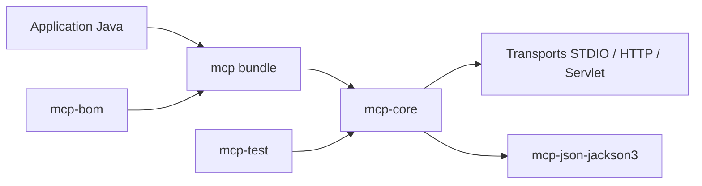

# modelcontextprotocol/java-sdk

> Official Java SDK for the Model Context Protocol, with synchronous or asynchronous clients and servers.

## The problem
For a Java application to talk to tools and models via MCP, you have to implement the protocol, its transports and its serialization.

## What it actually does
Maven modules: `mcp-core` (STDIO, JDK HttpClient, Servlet), Jackson 2 or 3 JSON binding, `mcp` bundle, `mcp-bom`, `mcp-test`. Reactive API (Reactor) with a synchronous facade, SLF4J logs and pluggable authorization hooks. Spring WebFlux and WebMVC integrations are in Spring AI 2.0+. MCP conformance tests: server 40/40, client 3/4 scenarios.

## How it is wired


## Trying it
```bash
./mvnw clean install -DskipTests
./mvnw test
```

## Cost and gotchas
Free. Tests require Docker and npx. According to the "future directions", the public API does not yet expose only Reactive Streams interfaces.

## What it is not
Not a ready-to-use MCP server nor a built-in authorization module: the SDK leaves that choice to the application.

## Alternatives
- modelcontextprotocol/csharp-sdk: .NET equivalent.
- Spring AI MCP: Spring Boot extension cited in the README.

## For you
Ignore unless you are building an MCP server or client in Java; otherwise the Python SDK is more direct.
