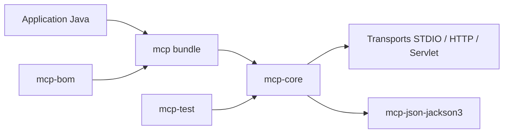

# modelcontextprotocol/java-sdk

> SDK Java officiel du Model Context Protocol, avec clients et serveurs synchrones ou asynchrones.

## Le problème
Pour qu'une application Java dialogue avec des outils et modèles via MCP, il faut implémenter le protocole, ses transports et sa sérialisation.

## Ce que ça fait vraiment
Modules Maven : `mcp-core` (STDIO, JDK HttpClient, Servlet), liaison JSON Jackson 2 ou 3, bundle `mcp`, `mcp-bom`, `mcp-test`. API réactive (Reactor) avec façade synchrone, logs SLF4J et hooks d'autorisation enfichables. Les intégrations Spring WebFlux et WebMVC sont dans Spring AI 2.0+. Tests de conformité MCP : serveur 40/40, client 3/4 scénarios.

## Comment c'est branché


## Essayer
```bash
./mvnw clean install -DskipTests
./mvnw test
```

## Coût et pièges
Gratuit. Les tests demandent Docker et npx. L'API publique n'expose pas encore uniquement les interfaces Reactive Streams, d'après les « directions futures ».

## Ce que ce n'est pas
Pas de serveur MCP prêt à l'emploi ni module d'autorisation intégré : le SDK laisse ce choix à l'application.

## Alternatives
- modelcontextprotocol/csharp-sdk : équivalent .NET.
- Spring AI MCP : extension Spring Boot citée dans le README.

## Pour toi
À ignorer sauf si tu construis un serveur ou client MCP en Java ; sinon le SDK Python est plus direct.

