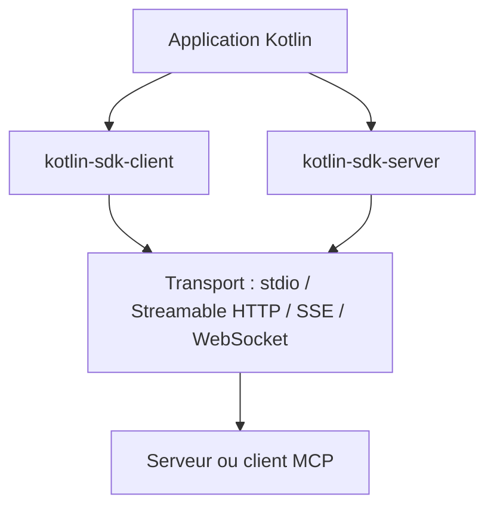

# modelcontextprotocol/kotlin-sdk

> Multiplatform Kotlin SDK to write MCP clients and servers on JVM, Native, JS and Wasm.

## The problem
Connecting a Kotlin application to tools and context for LLMs requires implementing the MCP protocol yourself.

## What it actually does
The SDK provides Maven artifacts (`kotlin-sdk`, `-client`, `-server`) that implement the protocol: prompts, resources, tools, sampling, roots, completion, logging and pagination. It offers stdio, SSE, Streamable HTTP and WebSocket transports, with coroutine APIs. It builds on Ktor, whose engines you must declare yourself.

## How it is wired
Simplified diagram based on the sheet, no diagram provided.



## Trying it
```kotlin
dependencies {
    implementation("io.modelcontextprotocol:kotlin-sdk:$mcpVersion")
}
```
```bash
npx -y @modelcontextprotocol/inspector
```

## Cost and gotchas
Free. You must declare the Ktor dependencies yourself. Streamable HTTP sessions stay in memory, with a default expiry of 30 minutes of inactivity. Elicitation is not yet documented.

## What it is not
Not a ready-to-use MCP server: a building block to build one. A license is present but not identified by GitHub, so read it.

## Alternatives
No alternative named in the README.

## For you
Worth watching: relevant only if you write MCP in Kotlin; in Python or TypeScript, the corresponding official SDKs fit better.
