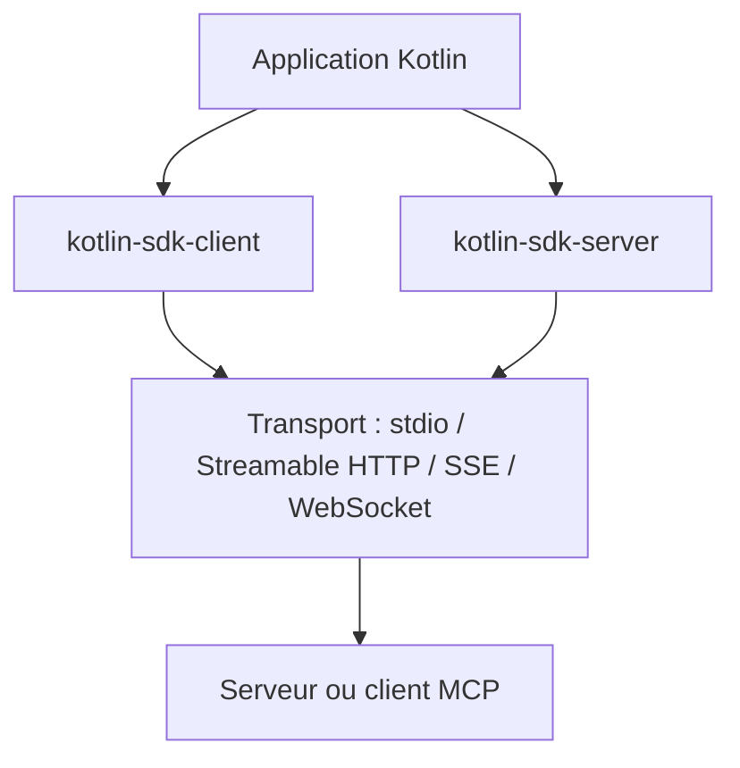

# modelcontextprotocol/kotlin-sdk

> SDK Kotlin multiplateforme pour écrire des clients et serveurs MCP sur JVM, Native, JS et Wasm.

## Le problème
Brancher une application Kotlin à des outils et contextes pour LLM demande d'implémenter soi-même le protocole MCP.

## Ce que ça fait vraiment
Le SDK fournit des artefacts Maven (`kotlin-sdk`, `-client`, `-server`) qui implémentent le protocole : prompts, ressources, outils, échantillonnage, racines, complétion, journalisation et pagination. Il propose les transports stdio, SSE, Streamable HTTP et WebSocket, avec des API à coroutines. Il s'appuie sur Ktor, dont les moteurs sont à déclarer soi-même.

## Comment c'est branché
Schéma simplifié d'après la fiche, sans diagramme fourni.



## Essayer
```kotlin
dependencies {
    implementation("io.modelcontextprotocol:kotlin-sdk:$mcpVersion")
}
```
```bash
npx -y @modelcontextprotocol/inspector
```

## Coût et pièges
Gratuit. Il faut déclarer soi-même les dépendances Ktor. Les sessions Streamable HTTP restent en mémoire, avec une expiration à 30 minutes d'inactivité par défaut. L'élicitation n'est pas encore documentée.

## Ce que ce n'est pas
Pas un serveur MCP prêt à l'emploi : une brique pour en construire. Licence présente mais non identifiée par GitHub, à lire.

## Alternatives
Aucune alternative nommée dans le README.

## Pour toi
À surveiller : pertinent seulement si tu écris du MCP en Kotlin ; en Python ou TypeScript, les SDK officiels correspondants conviennent mieux.

