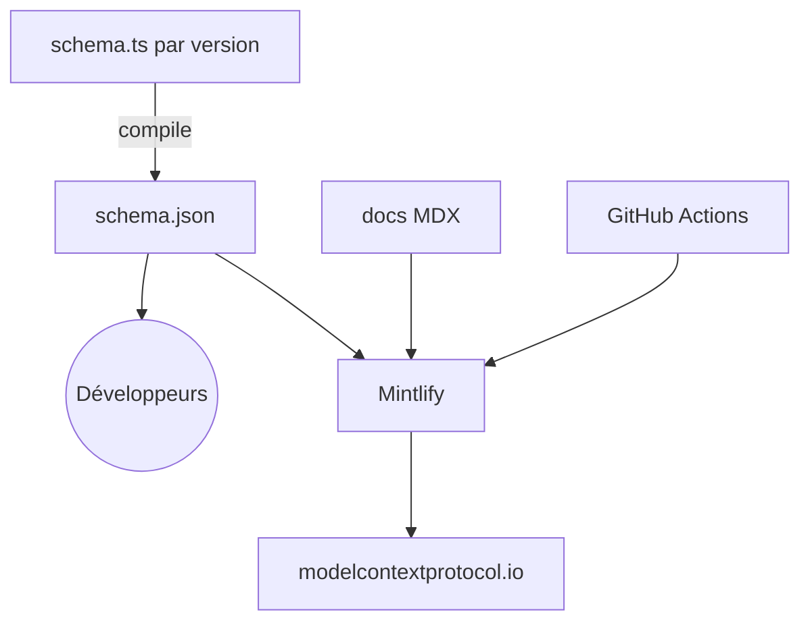

# modelcontextprotocol/modelcontextprotocol

> Official specification, schema and documentation of the MCP protocol, for anyone connecting tools to LLMs.

## The problem
Each assistant integrates its tools its own way, with no common contract.

## What it actually does
The repository contains the MCP specification, the schema defined in TypeScript then published as JSON Schema, and the documentation (MDX, Mintlify) on modelcontextprotocol.io. Specification versions are dated (2024-11-05, 2025-03-26, draft). No executable code: it is the source of the SDKs.

## How it is wired

## Trying it
No command documented in the README; it points to the documentation site.

## Cost and gotchas
Free. The license is not identified by GitHub: to be checked. The schema evolves through dated versions.

## What it is not
Not an SDK nor a server: it is the specification. Implementations live in other repositories.

## Alternatives
No alternative named in the README.

## For you
Adopt as a reference: if you build tools for LLMs, the MCP specification is the authoritative source.
