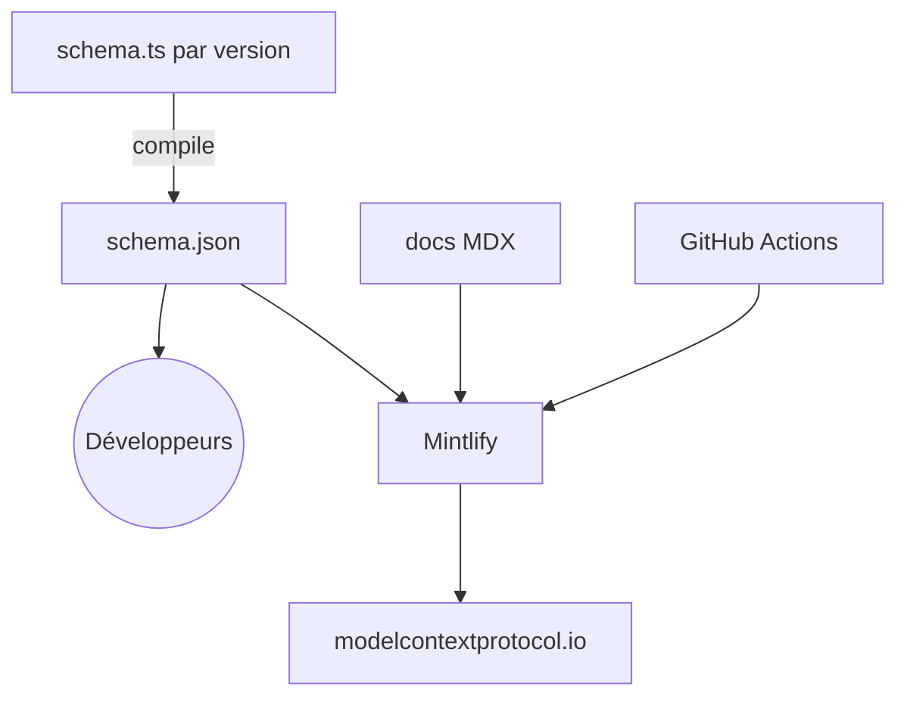

# modelcontextprotocol/modelcontextprotocol

> Spécification, schéma et documentation officielle du protocole MCP, pour qui relie des outils à des LLM.

## Le problème
Chaque assistant intègre ses outils à sa manière, sans contrat commun.

## Ce que ça fait vraiment
Le dépôt contient la spécification MCP, le schéma défini en TypeScript puis publié en JSON Schema, et la documentation (MDX, Mintlify) sur modelcontextprotocol.io. Les versions de la spécification sont datées (2024-11-05, 2025-03-26, draft). Aucun code exécutable : c'est la source des SDK.

## Comment c'est branché

## Essayer
Aucune commande documentée dans le README ; il renvoie au site de documentation.

## Coût et pièges
Gratuit. La licence n'est pas identifiée par GitHub : à vérifier. Le schéma évolue par version datée.

## Ce que ce n'est pas
Pas un SDK ni un serveur : c'est la spécification. Les implémentations sont dans d'autres dépôts.

## Alternatives
Aucune alternative nommée dans le README.

## Pour toi
À adopter comme référence : si tu construis des outils pour LLM, la spécification MCP est la source qui fait foi.

