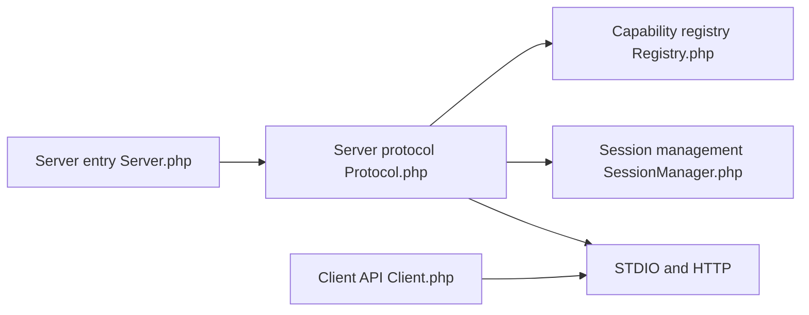

# modelcontextprotocol/php-sdk

> Official PHP SDK for writing MCP servers and clients, built by the PHP Foundation and Symfony.

## The problem
Exposing PHP tools to agents or consuming MCP servers requires implementing the protocol by hand.

## What it actually does
Framework-independent API: tools, resources, prompts via attributes (`#[McpTool]`, `#[McpResource]`), STDIO and HTTP transports, sessions, authorization, client. Handles the `initialize` handshake and the stateless `2026-07-28` revision. Conformance measured every week.

## How it is wired


## Trying it
```bash
composer require mcp/sdk
composer require symfony/finder
```

## Cost and gotchas
Free. The SDK is experimental before the first major version. Automatic discovery requires `symfony/finder`. License not identified by GitHub.

## What it is not
Not a ready-to-use MCP server: it is a library. The API may still change.

## Alternatives
No alternative named in the README; it cites libraries built on top of it (symfony/mcp-bundle, api-platform/mcp).

## For you
Worth watching: useful only if your stack is PHP; otherwise prefer an MCP SDK in your language. Check the license.
