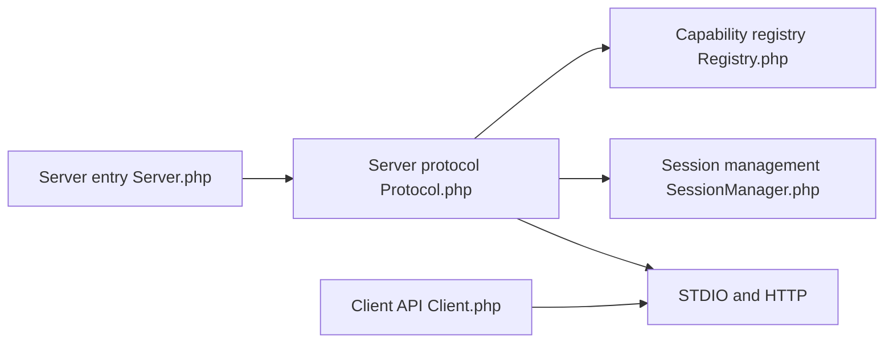

# modelcontextprotocol/php-sdk

> SDK PHP officiel pour écrire des serveurs et clients MCP, fruit de la PHP Foundation et de Symfony.

## Le problème
Exposer des outils PHP à des agents ou consommer des serveurs MCP exige d'implémenter le protocole à la main.

## Ce que ça fait vraiment
API indépendante du framework : outils, ressources, prompts via attributs (`#[McpTool]`, `#[McpResource]`), transports STDIO et HTTP, sessions, autorisation, client. Gère le handshake `initialize` et la révision sans état `2026-07-28`. Conformité mesurée chaque semaine.

## Comment c'est branché


## Essayer
```bash
composer require mcp/sdk
composer require symfony/finder
```

## Coût et pièges
Gratuit. Le SDK est expérimental avant la première version majeure. La découverte automatique exige `symfony/finder`. Licence non identifiée par GitHub.

## Ce que ce n'est pas
Pas un serveur MCP prêt à l'emploi : c'est une bibliothèque. L'API peut encore bouger.

## Alternatives
Aucune alternative nommée dans le README ; il cite des bibliothèques bâties dessus (symfony/mcp-bundle, api-platform/mcp).

## Pour toi
Surveiller : utile seulement si ta stack est en PHP ; sinon préfère un SDK MCP dans ton langage. Vérifie la licence.

