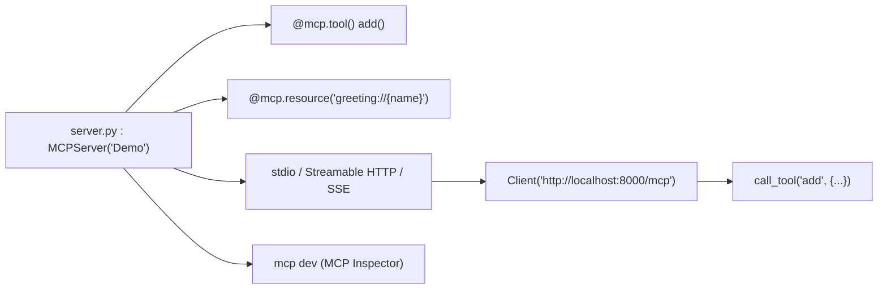

# modelcontextprotocol/python-sdk

> The official Python SDK for the Model Context Protocol, both server side and client side.

## The problem
Exposing tools to an LLM quickly turns into writing JSON Schema by hand, request parsing,
validation and transport plumbing — code that is not the point.

## What it actually does
An `@mcp.tool()` decorator turns an annotated function into a tool: the type annotations
*are* the schema, the docstring is the description. `@mcp.resource("greeting://{name}")` exposes a
parameterized resource. The same package provides the client (`Client`), which speaks stdio, Streamable HTTP
and SSE. The `mcp` CLI (`cli` extra) brings `mcp dev`, `mcp run` and `mcp install`.

## How it is wired


## Trying it
```bash
uv add "mcp[cli]"
uv run mcp dev server.py
uv run mcp run server.py --transport streamable-http
```

## Cost and gotchas
Python 3.10+. The pitfall is versioning: `pip install mcp` now installs 2.x, a major
overhaul. The README explicitly asks you to pin `>=1.28,<2` until the migration is done.
1.x survives on the `v1.x` branch with only critical and security fixes.

## What it is not
Not an MCP host: it produces servers and clients, not the application that orchestrates them.
Not a deployment: the README shows `localhost`, going to production is up to you.
Not stable in the API sense: v2 breaks, and the migration guide exists for that reason.

## Alternatives
- The `v1.x` branch of the same repository, if a migration is out of budget.

## For you
The foundation to know for exposing your own tools to an agent — start by pinning the version.
