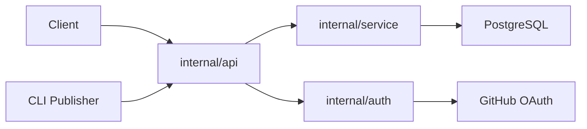

# modelcontextprotocol/registry

> Official registry of MCP servers: an "app store" queryable via API.

## The problem
MCP clients have no single, reliable source for discovering MCP servers.

## What it actually does
A Go API (routers, services, PostgreSQL) that lists and publishes MCP servers.
The `mcp-publisher` CLI publishes a `server.json`.
Namespace ownership is verified by GitHub OAuth or OIDC, DNS or HTTP.
API frozen at v0.1; during preview, resets remain possible.

## How it is wired


## Trying it
```bash
make dev-compose
make publisher
./bin/mcp-publisher --help
```

## Cost and gotchas
Free; Docker, Go and ko are needed to develop. The Docker image does not bundle PostgreSQL.

## What it is not
Not yet GA: breaking changes remain possible. It is not itself an MCP server.

## Alternatives
No alternative is named in the README.

## For you
Worth watching: useful for publishing or discovering MCP servers; no need to host it, the public API is enough.
