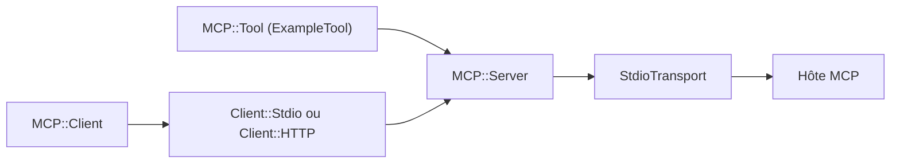

# modelcontextprotocol/ruby-sdk

> Ruby SDK for writing MCP servers and clients, aimed at Ruby and Rails developers.

## The problem
Plugging a Ruby or Rails application into the MCP ecosystem otherwise means reimplementing the JSON-RPC protocol by hand.

## What it actually does
The `mcp` gem lets you define tools, prompts and resources on the server side, and connect to an MCP server on the client side. It speaks stdio and Streamable HTTP (SSE included), with a Rails integration and OAuth 2.1 protection. The README announces protocol coverage: notifications, progress, cancellation, completions, pagination.

## How it is wired
Simplified diagram based on the fiche, no diagram provided.


## Trying it
```bash
bundle install
gem install mcp
ruby server.rb
```
In the Gemfile: `gem "mcp"`.

## Cost and gotchas
Free. The README warns that additional dependencies may be needed depending on the features used. A license is present but not identified by GitHub: check before use.

## What it is not
It is not a ready-to-use MCP server: it provides the building blocks, you write the tools. It only serves the Ruby ecosystem.

## Alternatives
No alternative named in the README.

## For you
Worth watching: useful only if your stack is Ruby or Rails; otherwise an SDK in your usual language is closer to your profile.
