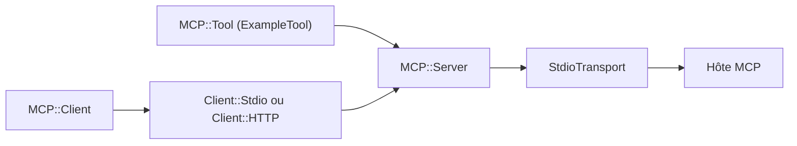

# modelcontextprotocol/ruby-sdk

> SDK Ruby pour écrire des serveurs et clients MCP, destiné aux développeurs Ruby et Rails.

## Le problème
Brancher une application Ruby ou Rails sur l'écosystème MCP oblige sinon à réimplémenter le protocole JSON-RPC à la main.

## Ce que ça fait vraiment
Le gem `mcp` permet de définir des outils, prompts et ressources côté serveur, et de se connecter à un serveur MCP côté client. Il parle stdio et Streamable HTTP (SSE inclus), avec une intégration Rails et une protection OAuth 2.1. Le README annonce la couverture du protocole : notifications, progression, annulation, complétions, pagination.

## Comment c'est branché
Schéma simplifié d'après la fiche, sans diagramme fourni.


## Essayer
```bash
bundle install
gem install mcp
ruby server.rb
```
Dans le Gemfile : `gem "mcp"`.

## Coût et pièges
Gratuit. Le README prévient que des dépendances supplémentaires peuvent être nécessaires selon les fonctions utilisées. La licence est présente mais non identifiée par GitHub : à vérifier avant usage.

## Ce que ce n'est pas
Ce n'est pas un serveur MCP prêt à l'emploi : il fournit les briques, tu écris les outils. Il ne sert que l'écosystème Ruby.

## Alternatives
Aucune alternative nommée dans le README.

## Pour toi
À surveiller : utile seulement si ta stack est Ruby ou Rails ; sinon un SDK dans ton langage habituel est plus proche de ton profil.

