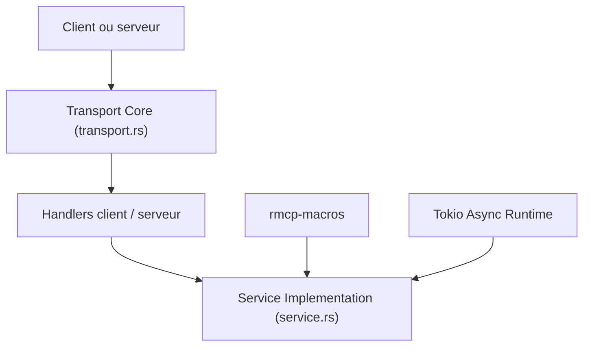

# modelcontextprotocol/rust-sdk

> Official Rust SDK for the Model Context Protocol, on the tokio runtime, for MCP clients and servers.

## The problem
Writing an MCP server or client in Rust means implementing JSON-RPC, the transports and the tool schemas by hand.

## What it actually does
Two crates: rmcp, the core (message model, handlers, service, transports) and rmcp-macros, which generates the wiring for tools and prompts with #[tool] and #[prompt]. It covers tools, resources, prompts, sampling (marked deprecated) and user elicitation. It implements the MCP 2026-07-28 specification and remains compatible with 2025-11-25. Transports include child process, stdio, SSE and WebSocket.

## How it is wired


## Trying it
```bash
cargo add rmcp --features server
cargo add rmcp --features server --git https://github.com/modelcontextprotocol/rust-sdk --branch main
```

## Cost and gotchas
Free. Rust and tokio are required. A migration to version 3.x brings breaking changes, described in a guide. The catalog does not recognize the license.

## What it is not
It is not a ready-to-use MCP server: it is a library for building one. The README provided is truncated after the part on user elicitation.

## Alternatives
No alternative named in the README.

## For you
Keep an eye on it: useful if you expose data tools to agents in Rust, otherwise a Python or TypeScript SDK will suit your daily work better.
