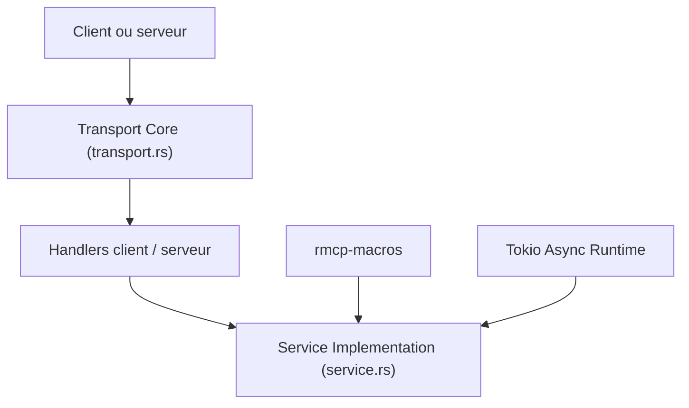

# modelcontextprotocol/rust-sdk

> SDK Rust officiel du Model Context Protocol, sur runtime tokio, pour clients et serveurs MCP.

## Le problème
Écrire un serveur ou un client MCP en Rust suppose d'implémenter à la main JSON-RPC, les transports et les schémas des outils.

## Ce que ça fait vraiment
Deux crates : rmcp, le cœur (modèle de messages, gestionnaires, service, transports) et rmcp-macros, qui génère le câblage des outils et des prompts avec #[tool] et #[prompt]. Il couvre outils, ressources, prompts, échantillonnage (marqué obsolète) et sollicitation de l'utilisateur. Il implémente la spécification MCP 2026-07-28 et reste compatible avec 2025-11-25. Les transports incluent processus fils, stdio, SSE et WebSocket.

## Comment c'est branché


## Essayer
```bash
cargo add rmcp --features server
cargo add rmcp --features server --git https://github.com/modelcontextprotocol/rust-sdk --branch main
```

## Coût et pièges
Gratuit. Rust et tokio sont nécessaires. Une migration vers la version 3.x apporte des changements incompatibles, décrits dans un guide. Le catalogue ne reconnaît pas la licence.

## Ce que ce n'est pas
Ce n'est pas un serveur MCP prêt à l'emploi : une bibliothèque pour en construire. Le README fourni est tronqué après la partie sur la sollicitation de l'utilisateur.

## Alternatives
Aucune alternative nommée dans le README.

## Pour toi
Surveiller : utile si tu exposes des outils de données à des agents en Rust, sinon un SDK Python ou TypeScript conviendra mieux à ton quotidien.

