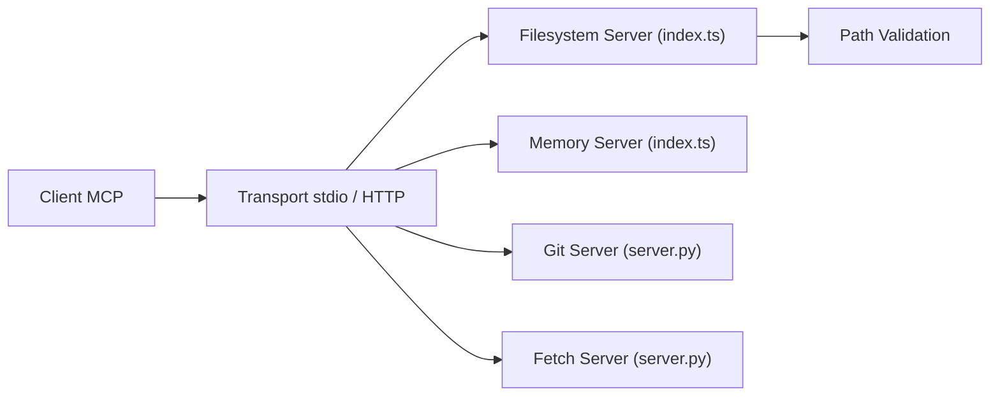

# modelcontextprotocol/servers

> Reference servers for the Model Context Protocol, serving as examples for MCP server developers.

## The problem
A language model does not access files, Git or the web by itself; a common protocol and examples are needed to plug in tools in a controlled way.

## What it actually does
Seven reference servers: Everything (test), Fetch (web to text), Filesystem (controlled access), Git, Memory (knowledge graph), Sequential Thinking and Time. An MCP client launches the server via stdio or HTTP; the server validates the request and returns MCP content. TypeScript servers run via `npx`, Python servers via `uvx` or `pip`. The former servers (GitHub, PostgreSQL, Slack…) are archived elsewhere.

## How it is wired


## Trying it
```bash
npx -y @modelcontextprotocol/server-memory
uvx mcp-server-git
pip install mcp-server-git
python -m mcp_server_git
```
Then add the server to the client's configuration file (the `mcpServers` block from the README).

## Cost and gotchas
Free. The README warns: these are reference implementations, not production-ready solutions; each user evaluates their own security. Its configuration examples still cite `server-github` and `server-postgres`, listed as archived. License present but not identified by GitHub.

## What it is not
Neither a directory of MCP servers (see the MCP Registry), nor a security guarantee. The Filesystem server gives real access to your files within the allowed paths.

## Alternatives
- MCP Registry: to browse published servers.
- servers-archived: to find GitHub, PostgreSQL, Slack and other archived servers.

## For you
Adopt as an MCP learning base: the short code shows how to equip an agent with tools, provided you treat these servers as examples.
