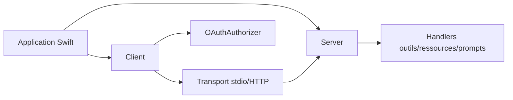

# modelcontextprotocol/swift-sdk

> Official Swift SDK for the MCP protocol, client and server side, for Apple and Linux developers.

## The problem
Connecting a Swift app to MCP servers, or exposing an MCP server in Swift, requires implementing the protocol by hand.

## What it actually does
Swift 6 library compliant with the MCP 2025-11-25 specification: client and server, stdio transports, HTTP client, stateful or stateless HTTP server, in-memory and network, tools, resources, prompts, completions, sampling, roots, logging, progress, cancellation, batches. OAuth 2.1 authentication (PKCE, protected resource metadata) is optional.

## How it is wired


## Trying it
```swift
dependencies: [
    .package(url: "https://github.com/modelcontextprotocol/swift-sdk.git", from: "0.11.0")
]
```

## Cost and gotchas
Free. Swift 6 / Xcode 16 required; the README specifies minimum versions per platform. Version 0.11: the API may still change.

## What it is not
Not a ready-to-run server: you have to write your own handlers. Token storage is in memory by default. A license is present but not identified by GitHub.

## Alternatives
No alternative named in the README.

## For you
Ignore: only useful if you develop in Swift; for a Python data/AI profile, an SDK in another language serves better.
