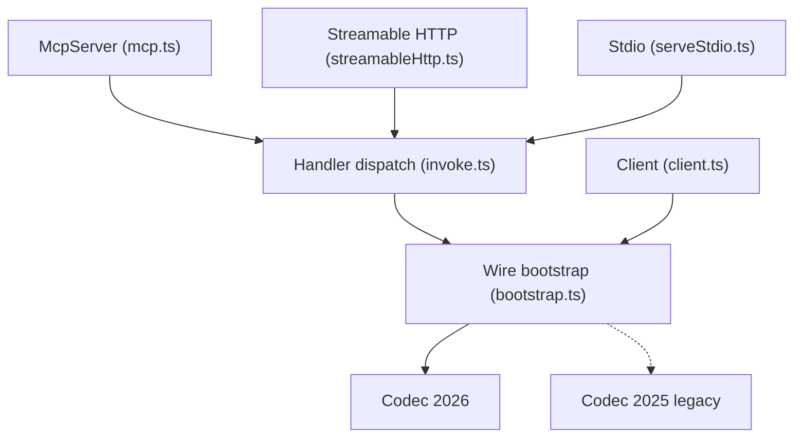

# modelcontextprotocol/typescript-sdk

> Official TypeScript SDK for writing MCP servers and clients, aimed at developers of tools for LLMs.

## The problem
Every application that wants to give context or tools to an LLM reinvents its protocol. Without an SDK, you have to hand-code JSON-RPC, transports and authentication.

## What it actually does
Two packages, `@modelcontextprotocol/server` and `@modelcontextprotocol/client`, run on Node, Bun and Deno. The server registers tools, resources and prompts, validated by Standard Schema (Zod v4, Valibot, ArkType), and exposes them over stdio or Streamable HTTP. The client negotiates the protocol version and handles OAuth. Thin adapters cover Express, Fastify, Hono and Node HTTP. A codemod migrates from v1 to v2.

## How it is wired


## Trying it
```bash
npm install @modelcontextprotocol/server
npm install @modelcontextprotocol/client
```
The README then gives a minimal stdio `greet` server (`McpServer`, `registerTool`, `StdioServerTransport`).

## Cost and gotchas
Free, no API key required by the SDK. The `main` branch is v2; v1 (`@modelcontextprotocol/sdk`) lives on `v1.x`, so be careful not to mix the two documentations.

## What it is not
Not a ready-to-use MCP server: it is a building block for writing one. No LLM provider included. The license is present but not identified by GitHub.

## Alternatives
No alternative named in the README; v1 remains available on the `v1.x` branch.

## For you
Adopt if you build MCP tools or agents in TypeScript: it is the reference implementation, very active, and the license should be checked before commercial use.
