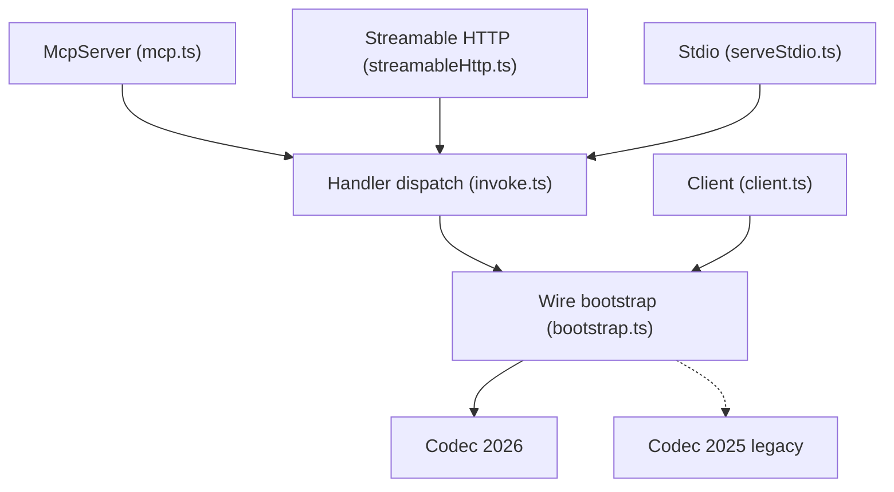

# modelcontextprotocol/typescript-sdk

> SDK TypeScript officiel pour écrire des serveurs et clients MCP, destiné aux développeurs d'outils pour LLM.

## Le problème
Chaque application qui veut donner du contexte ou des outils à un LLM réinvente son protocole. Sans SDK, il faut coder à la main JSON-RPC, transports et authentification.

## Ce que ça fait vraiment
Deux paquets, `@modelcontextprotocol/server` et `@modelcontextprotocol/client`, tournent sur Node, Bun et Deno. Le serveur enregistre outils, ressources et prompts, validés par Standard Schema (Zod v4, Valibot, ArkType), et les expose en stdio ou Streamable HTTP. Le client négocie la version du protocole et gère OAuth. Des adaptateurs fins couvrent Express, Fastify, Hono et Node HTTP. Un codemod migre de la v1 vers la v2.

## Comment c'est branché


## Essayer
```bash
npm install @modelcontextprotocol/server
npm install @modelcontextprotocol/client
```
Le README donne ensuite un serveur `greet` minimal en stdio (`McpServer`, `registerTool`, `StdioServerTransport`).

## Coût et pièges
Gratuit, aucune clé d'API requise par le SDK. La branche `main` est la v2 ; la v1 (`@modelcontextprotocol/sdk`) vit sur `v1.x`, donc attention à ne pas mélanger les deux documentations.

## Ce que ce n'est pas
Ce n'est pas un serveur MCP prêt à l'emploi : c'est une brique pour en écrire. Pas de fournisseur LLM inclus. La licence est présente mais non identifiée par GitHub.

## Alternatives
Aucune alternative nommée dans le README ; la v1 reste disponible sur la branche `v1.x`.

## Pour toi
À adopter si tu construis des outils ou agents MCP en TypeScript : c'est l'implémentation de référence, très active, et la licence reste à vérifier avant un usage commercial.

