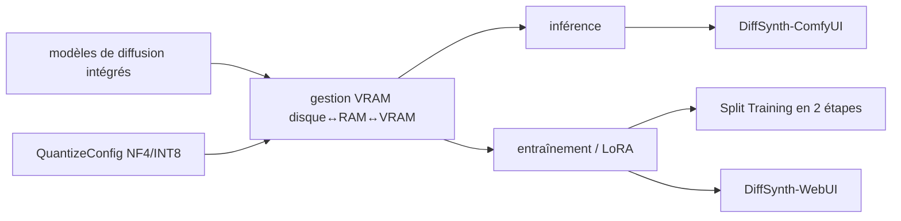

# modelscope/DiffSynth-Studio

> Open source diffusion model engine: image, video and audio inference and training.

## The problem
Every new diffusion model arrives with its own inference code, and large models do not fit in the
VRAM of a consumer GPU.

## What it actually does
The framework integrates the main open diffusion models — image, video and audio generation, and
image quality metric models (FID, CLIP, Aesthetic, PickScore, ImageReward, HPSv2, HPSv3). Its VRAM
management dynamically moves parameters between disk, memory and VRAM, with layer-level offload.
Quantization (`QuantizeConfig`, bitsandbytes, torchao and comfy-kitchen backends) goes down to NF4
and INT8, including for LoRA training. Almost every model that can be run for inference can also be
trained — base model, LoRA or adapter — and "Split Training" separates data processing from
training through a computation graph engine.

## How it is wired

## Trying it
No install or run command is present in the readable part of the README: it points to the developer
documentation (Chinese and English versions) and to the per-model example folders, for instance
`./examples/diffsynth_music/`.

## Cost and gotchas
Free, but it is a GPU that pays: quantization and CPU offload (`--enable_model_cpu_offload`,
single-GPU only) exist precisely to fit on consumer hardware. The README warns that the project has
undergone a major overhaul and that some older features are no longer maintained — you have to
switch to a historical version to get them back.

## What it is not
It is not a stable deployment engine: the authors point to DiffSynth-Engine for industrial
production use. Nor is it a large-team project — they warn that development rests on few people,
that new features arrive slowly and that issue response is limited. SD v1.5 and SDXL are supported
for research only.

## Alternatives
- DiffSynth-Engine: same family, oriented toward stable deployment and industrial performance.
- DiffSynth-ComfyUI: to build workflows in ComfyUI rather than in Python.
- DiffSynth-WebUI: lightweight LoRA training tool for consumer GPUs.

## For you
Worth watching if you do image generation: per-layer offload and quantization are what make a 20B
model usable on a desktop card.
