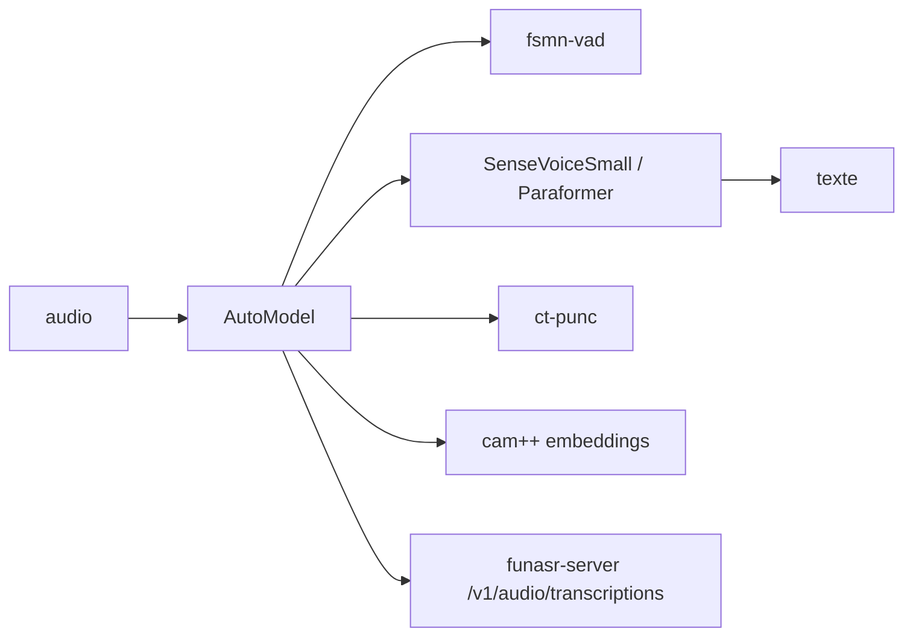

# modelscope/FunASR

> Industrial-grade speech recognition toolkit: transcription, VAD, punctuation, speakers, emotions.

## The problem
Transcribing Chinese or multilingual audio with Whisper gives disappointing error rates on Chinese.
And assembling VAD, punctuation and speaker segmentation yourself amounts to recoding an entire pipeline.

## What it actually does
Assembles task, checkpoint and runtime separately: `AutoModel` composes ASR, VAD, punctuation, speakers.
Provides a CLI (`funasr audio.wav`, JSON or SRT outputs) and an OpenAI API-compatible server.
Offers a CPU/edge path in llama.cpp/GGUF, standalone binary, no Python at runtime.
The model zoo ranges from SenseVoiceSmall (234M, zh/en/ja/ko/yue + emotions) to Fun-ASR-Nano (800M).

## How it is wired


## Trying it
```bash
pip install torch torchaudio
pip install funasr
funasr audio.wav --output-format srt --output-dir ./subs
```
Local CPU service: `funasr-server --host 127.0.0.1 --port 8000 --model sensevoice --device cpu`.

## Cost and gotchas
The HTTP service has no authentication: the README asks to keep it on the loopback interface.
`device="cuda"` only after checking that `torch.cuda.is_available()` returns `True`.

## What it is not
Speaker indices are anonymous and local to a recording: this is not identification of people.
Language coverage depends on the checkpoint: Nano (zh/en/ja) and MLT-Nano (31 languages) are two distinct choices.
Model licenses are separate from the toolkit's MIT license.

## Alternatives
`Whisper-large-v3` / `-turbo`: multilingual with translation, listed in the zoo as an option.
`Qwen3-ASR` (52 languages) or `GLM-ASR-Nano` (17 languages): if coverage matters more than Chinese.
`MOSS-Transcribe-Diarize` (OpenMOSS): for text, timestamps and speakers in a single offline pass.

## For you
The best choice if you transcribe Chinese or want a CPU binary with no Python in production.
