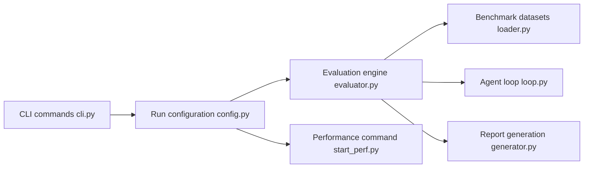

# modelscope/evalscope

> Evaluation framework for LLMs, VLMs and inference services, with benchmarks, stress tests and a dashboard.

## The problem
Comparing models requires wiring up each benchmark, measuring service latency and throughput, and aggregating the results.

## What it actually does
`evalscope eval` runs benchmarks (MMLU, C-Eval, GSM8K, SWE-bench, etc.) on a model via an OpenAI/Anthropic API or locally. An agent mode drives the benchmarks in a multi-turn loop with tools and a Docker sandbox; a bridge drives Claude Code or Codex. A perf module measures TTFT, TPOT and throughput. Arena mode with head-to-head duels, OpenCompass, VLMEvalKit and RAGEval backends, web dashboard.

## How it is wired


## Trying it
```bash
pip install evalscope
evalscope eval --model your-model-name --api-url $OPENAI_API_BASE_URL --api-key $OPENAI_API_KEY --eval-type openai_api --datasets gsm8k --limit 5
pip install 'evalscope[service]'
evalscope service
```

## Cost and gotchas
Evaluating an API consumes billed tokens; a local model downloads its weights. Remember `--limit` for testing. No GPU required in API mode.

## What it is not
Not a hosted leaderboard nor a guarantee of quality: scores depend on the config. Many agent benchmarks require Docker.

## Alternatives
- OpenCompass: text evaluation oriented.
- VLMEvalKit: multimodal evaluation.
- RAGEval: RAG evaluation.

## For you
Adopt: a single tool to compare your models and measure your inference endpoints, actively maintained (v1.11.0, August 2026).
