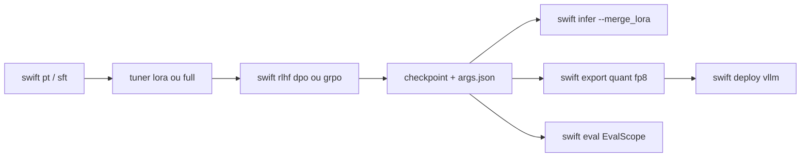

# modelscope/ms-swift

> Complete pipeline for training, aligning, evaluating and deploying LLMs and VLMs.

## The problem
Chaining fine-tuning, alignment, quantization, evaluation and serving would otherwise
mean assembling five libraries with incompatible conventions.

## What it actually does
Supports 600+ text models and 400+ multimodal ones, 150+ built-in datasets. Lightweight
methods: LoRA, QLoRA, DoRA, LoRA+, LLaMAPro, LongLoRA, LoRA-GA, ReFT, RS-LoRA,
Adapter, LISA. Training on quantized models BNB, AWQ, GPTQ, AQLM, HQQ, EETQ —
9 GB is enough for a 7B. Memory: GaLore, Q-GaLore, UnSloth, Liger-Kernel,
Flash-Attention 2/3, Ulysses and Ring-Attention sequence parallelism. Distributed:
DDP, DeepSpeed ZeRO2/ZeRO3, FSDP/FSDP2, and Megatron with TP/PP/SP/CP/ETP/EP/VPP for
MoE. Alignment: DPO, GKD, KTO, RM, CPO, SimPO, ORPO, PPO, and the GRPO family
(GRPO, DAPO, GSPO, SAPO, CISPO, CHORD, RLOO, Reinforce++). Embedding,
Reranker and sequence classification tasks. Accelerated inference with vLLM, SGLang, LMDeploy,
evaluation via EvalScope, export-time quantization AWQ/GPTQ/FP8/BNB, Gradio Web-UI.

## How it is wired


## Trying it
```bash
pip install ms-swift -U
CUDA_VISIBLE_DEVICES=0 swift sft --model Qwen/Qwen3-4B-Instruct-2507 --tuner_type lora --dataset 'AI-ModelScope/alpaca-gpt4-data-zh#500' --output_dir output
CUDA_VISIBLE_DEVICES=0 swift infer --adapters output/vx-xxx/checkpoint-xxx --stream true
SWIFT_UI_LANG=en swift web-ui
```

## Cost and gotchas
Free, but it is GPU work: the quick-start example announces 13 GB on a 3090 for
a 4B with LoRA. Strict dependency matrix (torch ≥2.0, transformers ≥4.33,
datasets <4.8.5, peft <0.21, trl <1.0). By default models and datasets come from
ModelScope, not Hugging Face: `--use_hf true` reverses that. The `main` branch is
swift 4.x; for 3.x you need `git checkout release/3.12`.

## What it is not
Not a managed service or an API: a command-line framework, heavily parameterized. The
surface is huge, so the documentation it points to is huge too — it is not
a tool you pick up in an hour.

## Alternatives
- Megatron-SWIFT: the same repository in Megatron mode, for large clusters and MoE.
- EvalScope: the evaluation backend, usable on its own.

## For you
The Swiss army knife to keep at hand for serious fine-tuning, especially if the
models come from ModelScope.
