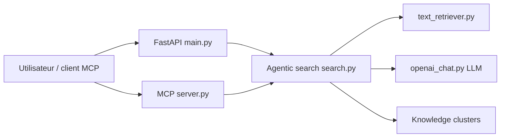

# modelscope/sirchmunk

> Agentic search engine without a vector database over raw files, with reusable knowledge clusters.

## The problem
A classic RAG requires indexing and reindexing documents; embeddings become stale as soon as the files change.

## What it actually does
Searches directly in the files with ripgrep(-all), then an LLM judges candidate zones under a token budget (modes DEEP, FAST, FILENAME_ONLY). Each answer produces a persisted KnowledgeCluster (DuckDB/Parquet) that is reused by similarity. Exposed via Python SDK, CLI, FastAPI/SSE API, MCP server and web interface. A `compile` step in beta prebuilds indexes.

## How it is wired


## Trying it
```bash
pip install sirchmunk
sirchmunk init
sirchmunk search "How does authentication work?" ./src ./docs
sirchmunk search "config" --mode FILENAME_ONLY
sirchmunk web serve
```

## Cost and gotchas
OpenAI-compatible LLM API key at your expense (except in FILENAME_ONLY mode). DEEP: 10 to 30 s per query. Automatic installation of ripgrep-all at startup.

## What it is not
Not a proven replacement for vector RAG: the announced gains come from the README and a paper. Version 0.0.x.

## Alternatives
No alternative named; the README compares itself to classic vector RAG.

## For you
Worth watching: interesting approach for searching changing corpora without an index, but very young (0.0.7) and costly in LLM calls.
