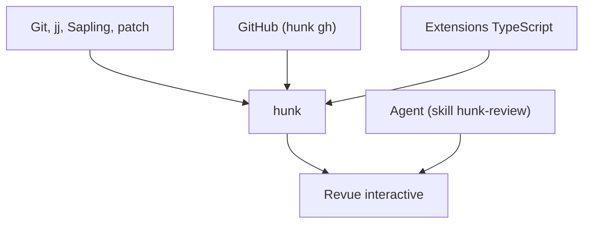

# modem-dev/hunk

> Interactive terminal diff viewer for reviewing code, with inline AI agent notes.

## The problem
Reviewing code changes in a terminal with `git diff` is hard to read, with no navigation between files.

## What it actually does
Shows a multi-file review flow with a sidebar, split or unified views, and automatic reloading. Can serve as a Git, Jujutsu or Sapling pager, open GitHub PRs, and display an agent's annotations via a review skill. TypeScript extensions, marked experimental.

## How it is wired
Simplified diagram based on the sheet, no diagram provided.



## Trying it
```bash
curl -fsSL https://hunk.dev/install.sh | sh
hunk diff
hunk diff --watch
hunk show HEAD~1
git config --global core.pager "hunk pager"
```

## Cost and gotchas
Free. Node.js 22+ only for the npm install. No binary for Windows arm64 or Linux musl. GitHub Enterprise not supported. 177 open issues.

## What it is not
No structural diff (the README's table marks it as absent). The extensions API may change between minor versions.

## Alternatives
lumen, difftastic, delta, diff-so-fancy.

## For you
Watch: useful for reviewing the changes a coding agent produces, but a young project (created in March 2026) with a still-unstable extensions API.
