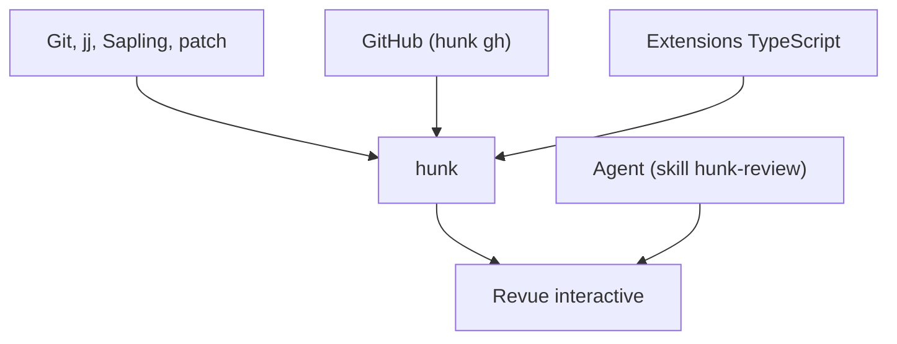

# modem-dev/hunk

> Visionneuse de diff interactive en terminal pour relire du code, avec notes d'agents IA en ligne.

## Le problème
Relire des changements de code dans un terminal avec `git diff` reste peu lisible, sans navigation entre fichiers.

## Ce que ça fait vraiment
Affiche un flux de revue multi-fichiers avec barre latérale, vues scindée ou unifiée, rechargement automatique. Peut servir de pager Git, Jujutsu ou Sapling, ouvrir des PR GitHub, et afficher des annotations d'un agent via un skill de revue. Extensions en TypeScript, marquées expérimentales.

## Comment c'est branché
Schéma simplifié d'après la fiche, sans diagramme fourni.



## Essayer
```bash
curl -fsSL https://hunk.dev/install.sh | sh
hunk diff
hunk diff --watch
hunk show HEAD~1
git config --global core.pager "hunk pager"
```

## Coût et pièges
Gratuit. Node.js 22+ seulement pour l'installation npm. Pas de binaire pour Windows arm64 ni Linux musl. GitHub Enterprise non pris en charge. 177 issues ouvertes.

## Ce que ce n'est pas
Pas de diff structurel (le tableau du README le marque absent). L'API d'extensions peut changer entre versions mineures.

## Alternatives
lumen, difftastic, delta, diff-so-fancy.

## Pour toi
À surveiller : utile pour relire les modifications que produit un agent de code, mais projet jeune (créé en mars 2026) et API d'extensions encore instable.

