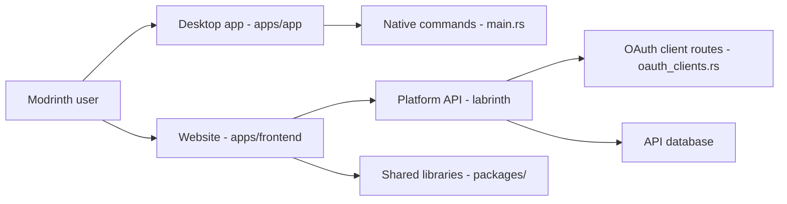

# modrinth/code

> Monorepo for the website, desktop app, API and docs of Modrinth, a Minecraft mod platform.

## The problem
Minecraft players have to find, install and manage mods and instances by hand. This repository is the code of the platform that answers that need.

## What it actually does
It groups four projects: the website (`apps/frontend`), the desktop app (`apps/app`, native Rust layer), the API (`apps/labrinth`) and the docs (`apps/docs`). Shared libraries live in `packages/`. Judging by the code, the API exposes OAuth routes backed by a database and authentication; the runtime links between the products are not documented.

## How it is wired

## Trying it
No command in the README: it points to one guide per project (website, app, API, docs). Not documented here.

## Cost and gotchas
Free. Building the app (Rust + front end) and running the API each require their own toolchain, detailed only in the external guides. License marked "to be verified": GitHub does not identify it.

## What it is not
Not a reusable tool: it is the code of one specific product. The README is very short and its figures (lines, contributors) are empty. Many open issues (993).

## Alternatives
None named in the README.

## For you
Ignore: unrelated to data/AI/MLOps, and the license must be verified before any reuse of the code.
