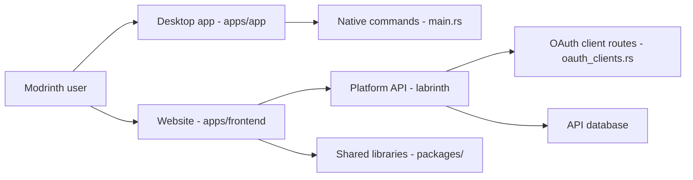

# modrinth/code

> Monorepo du site, de l'application de bureau, de l'API et de la doc de Modrinth, plateforme de mods Minecraft.

## Le problème
Les joueurs de Minecraft doivent trouver, installer et gérer des mods et des instances à la main. Ce dépôt est le code de la plateforme qui répond à ce besoin.

## Ce que ça fait vraiment
Il regroupe quatre projets : le site (`apps/frontend`), l'application de bureau (`apps/app`, couche Rust native), l'API (`apps/labrinth`) et la doc (`apps/docs`). Des bibliothèques partagées vivent dans `packages/`. D'après le code, l'API expose des routes OAuth adossées à une base et à l'authentification ; les liens d'exécution entre les produits ne sont pas documentés.

## Comment c'est branché

## Essayer
Aucune commande dans le README : il renvoie vers un guide par projet (site, app, API, doc). Non documenté ici.

## Coût et pièges
Gratuit. Compiler l'app (Rust + front) et lancer l'API demandent chacun leur chaîne d'outils, détaillée seulement dans les guides externes. Licence marquée « à vérifier » : GitHub ne l'identifie pas.

## Ce que ce n'est pas
Ce n'est pas un outil réutilisable : c'est le code d'un produit précis. Le README est très court et les chiffres (lignes, contributeurs) y sont vides. Beaucoup d'issues ouvertes (993).

## Alternatives
Aucune nommée dans le README.

## Pour toi
Ignorer : sans rapport avec data/IA/MLOps, et la licence est à vérifier avant tout réemploi du code.

