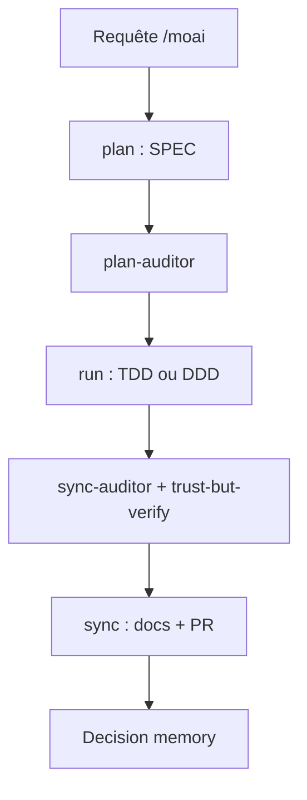

# modu-ai/moai-adk

> Harness around Claude Code that enforces plan, execution and synchronization with verification evidence.

## The problem
A coding agent claims "the tests pass" without proof, loses the thread after `/clear` and burns tokens in retry loops.

## What it actually does
A Go binary that wraps Claude Code: SPEC cycle plan → run → sync, independent audits, mandatory evidence reports, `/moai goal` with limits (turns, stagnation, duration), one worktree per SPEC, a four-terminal Kanban mode, a CG mode (Claude + GLM z.ai). 12 agents, 16 languages, a local web console. The cost figures come from the author.

## How it is wired


## Trying it
```bash
curl -fsSL https://adk.mo.ai.kr/install.sh | bash
moai init my-project
cd my-project
claude
```
Then `/moai plan "Add JWT login"`, `/moai run SPEC-AUTH-001`, `/moai sync SPEC-AUTH-001`.

## Cost and gotchas
Claude subscription or API at your expense; GLM (z.ai, from $10/month) optional. Kanban requires starting the sessions by hand. Windows: WSL recommended. Installation via `curl | bash`.

## What it is not
Not a replacement for Claude Code: a process layer on top of it. The architecture diagram provided describes an old Python version, while the current README describes a Go binary.

## Alternatives
The README only compares it to Claude Code alone and to "typical harnesses", without naming them.

## For you
Worth watching: the verification safeguards are interesting if you delegate a lot of code to an agent, but the framework is heavy and highly opinionated.
