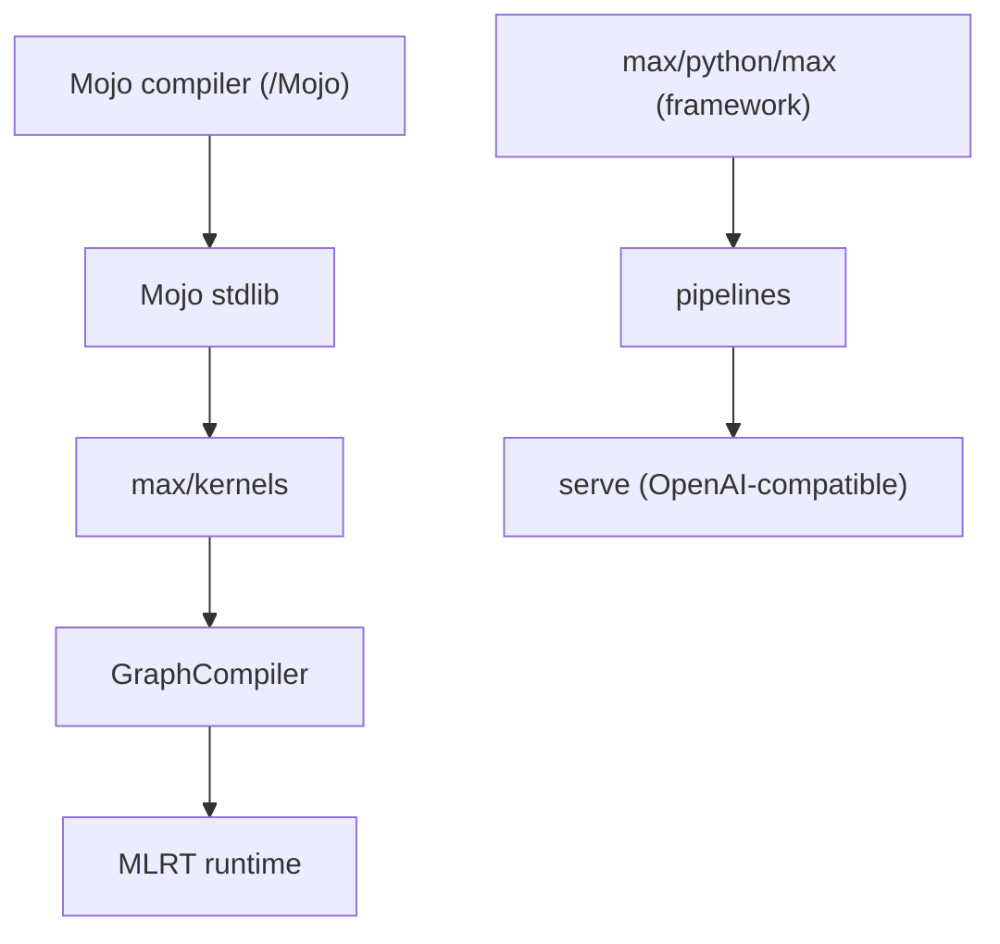

# modular/modular

> Open-source repository of the Modular platform: the Mojo language and the MAX framework for developing and serving AI models.

## The problem
Writing GPU kernels and serving models means juggling several stacks and languages.

## What it actually does
Hosts the Mojo compiler (published since August 2026), its standard library, GPU abstractions, compute kernels, the MAX graph compiler, the runtime, the Python model framework, pipelines and an OpenAI-compatible inference server.

## How it is wired

Diagram inferred from the README's list of components.

## Trying it
```bash
./bazelw run //Mojo:mojo -- Mojo/examples/hello.mojo
./bazelw run //max/python/max/_entrypoints:pipelines -- generate \
  --model Qwen/Qwen3.5-0.8B --max-batch-size 1 --max-length 10000 \
  --prompt "The sky is blue because"
```

## Cost and gotchas
Generation requires a compatible GPU. Build via Bazel from the repository. The README points to the get started guides for use outside the repository.

## What it is not
Not entirely open source: the README says other parts will be opened over time. License not identified by GitHub.

## Alternatives
None named in the README.

## For you
Worth watching: interesting for inference and GPU kernels, but the partial opening and the license to check suggest waiting.
