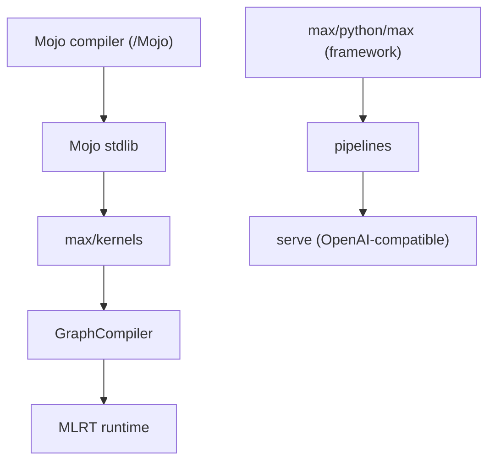

# modular/modular

> Dépôt open source de la plateforme Modular : langage Mojo et framework MAX pour développer et servir des modèles IA.

## Le problème
Écrire des noyaux GPU et servir des modèles demande de jongler entre plusieurs piles et langages.

## Ce que ça fait vraiment
Héberge le compilateur Mojo (publié depuis août 2026), sa bibliothèque standard, des abstractions GPU, des noyaux de calcul, le compilateur de graphes MAX, le runtime, le framework Python de modèles, les pipelines et un serveur d'inférence compatible OpenAI.

## Comment c'est branché

Schéma déduit de la liste des composants du README.

## Essayer
```bash
./bazelw run //Mojo:mojo -- Mojo/examples/hello.mojo
./bazelw run //max/python/max/_entrypoints:pipelines -- generate \
  --model Qwen/Qwen3.5-0.8B --max-batch-size 1 --max-length 10000 \
  --prompt "The sky is blue because"
```

## Coût et pièges
La génération exige un GPU compatible. Build via Bazel depuis le dépôt. Le README renvoie aux guides get started pour un usage hors dépôt.

## Ce que ce n'est pas
Pas tout open source : le README dit que d'autres parties seront ouvertes au fil du temps. Licence non identifiée par GitHub.

## Alternatives
Aucune nommée dans le README.

## Pour toi
À surveiller : intéressant pour l'inférence et les noyaux GPU, mais l'ouverture partielle et la licence à vérifier invitent à attendre.

