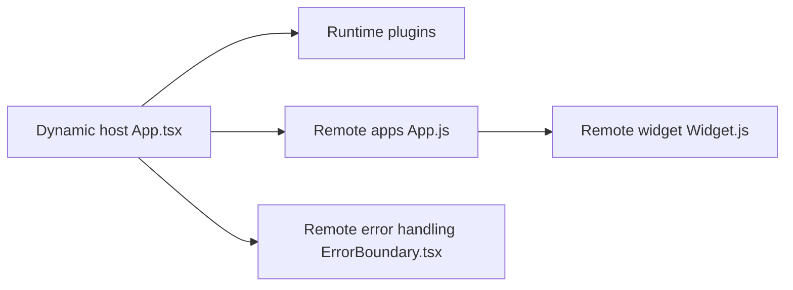

# module-federation/module-federation-examples

> Examples repository showing Webpack 5 Module Federation for sharing code between front-end applications.

## The problem
Understanding how to load modules from other builds at runtime (micro-frontends).

## What it actually does
Gathers many examples: dynamic remotes, synchronous imports, shared components, routing, SSR (Angular, Apollo), Svelte. The README points to the full list and the docs. The repository also contains commercial links (book, consulting, Zephyr Cloud).

## How it is wired


## Trying it
```bash
pnpm i
pnpm start
```
Run from the root, then from a non-proprietary example (some use `dev` or `serve`).

## Cost and gotchas
Free; pnpm and workspaces required. You must delete the "proprietary" example folders before installing from a git checkout.

## What it is not
It is not a library: these are front-end demos with no stable API.

## Alternatives
No alternative named in the README.

## For you
Ignore: a purely front-end subject, unrelated to data or MLOps.
