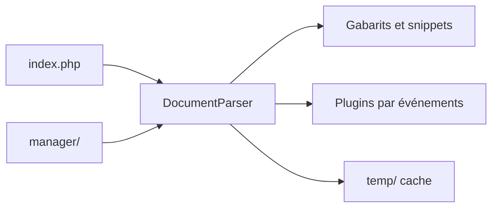

# modxcms-jp/evolution-jp

> Japanese edition of the PHP CMS Evolution CMS, for those publishing sites with tree-structured pages.

## The problem
Managing a content site requires a clear page structure, templates and a fast cache.

## What it actually does
PHP CMS: pages in a tree, file cache, a `DocumentParser` that handles the request from `index.php`, templates, chunks, snippets, placeholders, and plugins via events from `OnWebPageInit` to `OnWebPageComplete`. An `/install/` wizard configures the installation.

## How it is wired


## Trying it
```bash
# Pas de commande : extraire l'archive à la racine web,
# ouvrir /install/ dans le navigateur, puis supprimer install/
```

## Cost and gotchas
Free. Requires PHP 7.4+ (8.2 recommended), mbstring, mysqli and MySQL/MariaDB, i.e. PHP and a database (absent from the list). Upgrade possible only from 1.0.0J. GPL license cited in the README but not declared in the catalog.

## What it is not
Not a data tool: it is a CMS. Documentation in Japanese.

## Alternatives
No alternative named in the README.

## For you
Ignore: Japanese PHP CMS, unrelated to data or AI.
