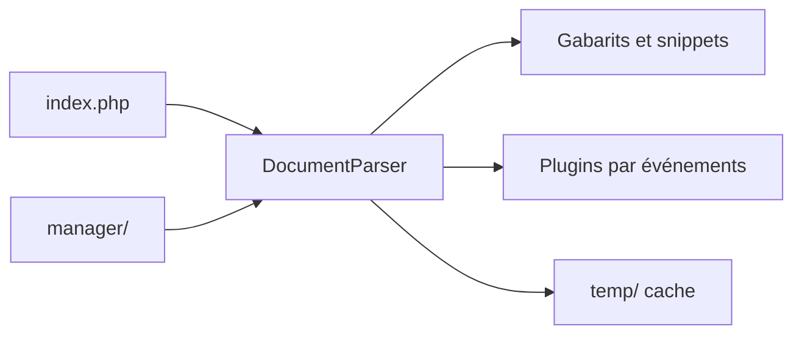

# modxcms-jp/evolution-jp

> Édition japonaise du CMS PHP Evolution CMS, pour qui publie des sites avec pages en arbre.

## Le problème
Gérer un site de contenus demande une structure de pages claire, des gabarits et un cache rapide.

## Ce que ça fait vraiment
CMS en PHP : pages en arborescence, cache fichier, `DocumentParser` qui traite la requête depuis `index.php`, gabarits, chunks, snippets, placeholders, et plugins via des événements de `OnWebPageInit` à `OnWebPageComplete`. Un assistant `/install/` configure l'installation.

## Comment c'est branché


## Essayer
```bash
# Pas de commande : extraire l'archive à la racine web,
# ouvrir /install/ dans le navigateur, puis supprimer install/
```

## Coût et pièges
Gratuit. Exige PHP 7.4+ (8.2 conseillé), mbstring, mysqli et MySQL/MariaDB, soit PHP et une base (absents de la liste). Mise à jour possible depuis 1.0.0J seulement. Licence GPL citée dans le README mais non déclarée dans le catalogue.

## Ce que ce n'est pas
Pas un outil de données : c'est un CMS. Documentation en japonais.

## Alternatives
Aucune alternative nommée dans le README.

## Pour toi
À ignorer : CMS PHP japonais, sans rapport avec la data ou l'IA.

