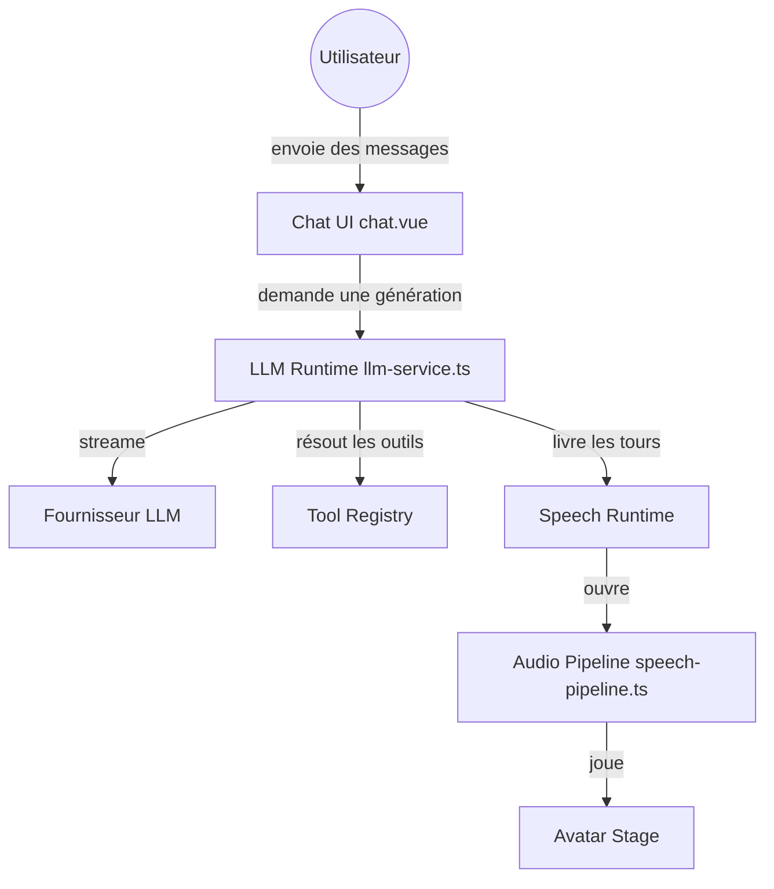

# moeru-ai/airi

> A virtual companion, powered by an LLM, that can converse and play, accessible through a web browser, desktop, and mobile devices.

## The problem
Platforms that allow you to chat with virtual characters do not play, do not see what you are doing, and do not remain under your control. The virtual streamer Neuro-sama has been shut down.

## What it actually does
A Vue/TypeScript application in three versions: web (`stage-web`), Electron desktop (`stage-tamagotchi`), and mobile (`stage-pocket`, experimental). An LLM engine streams responses, calls external tools and MCPs, and then an audio pipeline transforms them into synchronized speech with a Live2D or VRM avatar. Integrations are available for Discord, Minecraft, and Factorio. The desktop version uses CUDA or Metal natively.

## How it is wired


## Trying it
```bash
pnpm i
pnpm dev
# version bureau
pnpm dev:tamagotchi
# installation sous Windows
winget install MoeruAI.AIRI
# installation sous macOS
brew install --cask airi
```

## Cost and gotchas
For full functionality: you are responsible for providing the API keys for the LLM and speech synthesis, or for using local models on a GPU. The mobile version uses Capacitor and a simulator. The README specifies that there is no official cryptocurrency.

## What it is not
This is not a productivity or MLOps tool. The project identifies its purpose early in its development.

## Alternatives
kimjammer/Neuro, semperai/amica, elizaOS/eliza, t41372/Open-LLM-VTuber: other open-source virtual companions or agents.

## For you
This is not suitable for a data/MLOps profile: it's a general-purpose, experimental tool with no connection to your existing workflows.
