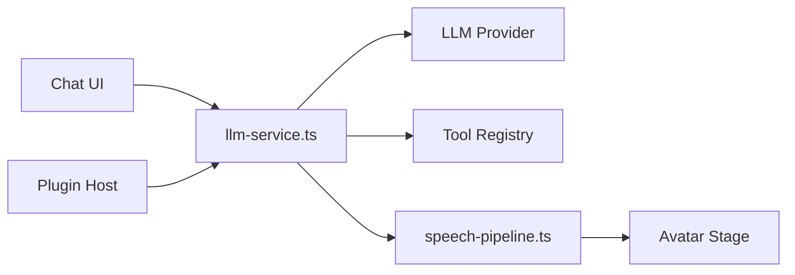

# moeru-ai/airi

> Compagnon virtuel IA auto-hébergé, type VTuber, qui discute, joue et parle, en web, bureau et mobile.

## Le problème
Neuro-sama n'est pas open source ; il manque une alternative que l'on possède et qui fait plus que du chat (jeux, voix, vision).

## Ce que ça fait vraiment
Un client (web, desktop Electron, mobile Capacitor) envoie la conversation à un LLM de ton choix, résout des outils et des workflows, puis produit parole en streaming et avatar animé (Live2D, VRM). Intégrations Discord, Minecraft, Factorio, MCP. Le README se dit « au stade précoce ».

## Comment c'est branché


## Essayer
```bash
pnpm i
pnpm dev
```
Version bureau : `pnpm dev:tamagotchi`.

## Coût et pièges
Gratuit ; LLM, voix et clés à ta charge. Le README précise qu'aucune cryptomonnaie officielle n'existe. Chemin natif CUDA/Metal sur bureau, WebGPU dans le navigateur.

## Ce que ce n'est pas
Pas un produit stabilisé. Pas un service hébergé garanti, même si une démo web existe.

## Alternatives
kimjammer/Neuro, Open-LLM-VTuber (t41372), semperai/amica : cités comme projets similaires.

## Pour toi
À surveiller : bon terrain d'étude pour un pipeline LLM+TTS+vision temps réel, mais trop expérimental et orienté divertissement pour du MLOps.

