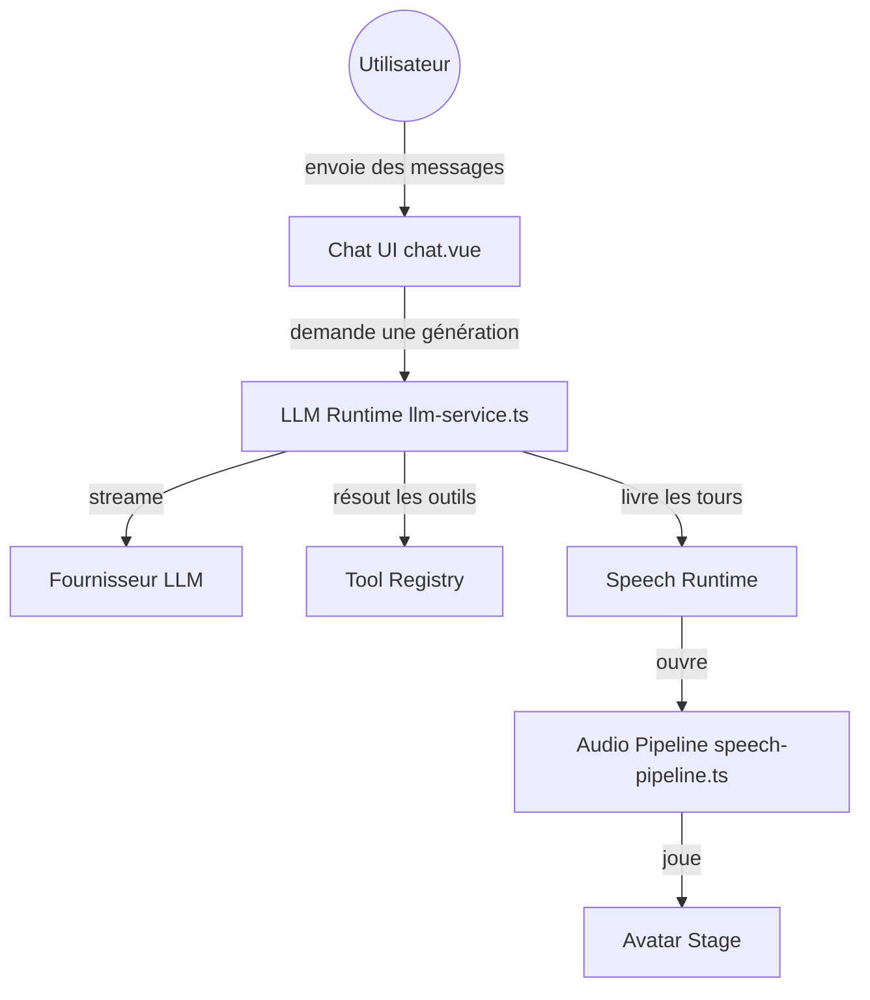

# moeru-ai/airi

> Compagnon virtuel animé, piloté par un LLM, qui discute et joue, sur navigateur, bureau et mobile.

## Le problème
Les plateformes de chat à personnages ne jouent pas, ne voient pas ce que tu fais et ne restent pas sous ton contrôle. Le streamer virtuel Neuro-sama est fermé.

## Ce que ça fait vraiment
Une application Vue/TypeScript en trois versions : web (`stage-web`), bureau Electron (`stage-tamagotchi`) et mobile (`stage-pocket`, expérimental). Un moteur LLM streame les réponses, appelle des outils et des MCP, puis un pipeline audio les transforme en voix synchronisée avec un avatar Live2D ou VRM. Des intégrations existent pour Discord, Minecraft et Factorio. Le bureau utilise CUDA ou Metal en natif.

## Comment c'est branché


## Essayer
```bash
pnpm i
pnpm dev
# version bureau
pnpm dev:tamagotchi
# installation sous Windows
winget install MoeruAI.AIRI
# installation sous macOS
brew install --cask airi
```

## Coût et pièges
Pour un usage complet : clés d'API de LLM et de synthèse vocale à ta charge, ou modèles locaux sur GPU. La version mobile passe par Capacitor et un simulateur. Le README précise qu'aucune cryptomonnaie officielle n'existe.

## Ce que ce n'est pas
Ce n'est pas un outil de productivité ni de MLOps. Le projet se dit lui-même à un stade précoce de développement.

## Alternatives
kimjammer/Neuro, semperai/amica, elizaOS/eliza, t41372/Open-LLM-VTuber : autres compagnons ou agents virtuels open source.

## Pour toi
À ignorer pour un profil data/MLOps : c'est un compagnon grand public, expérimental, sans lien avec tes pipelines.

