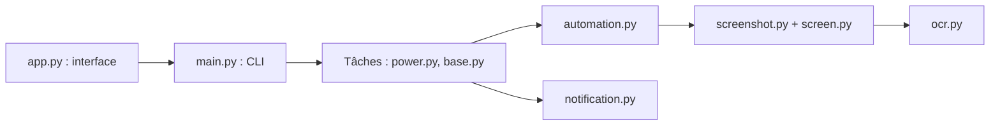

# moesnow/March7thAssistant

> Automation assistant for the game Honkai: Star Rail: daily and weekly tasks, notifications.

## The problem
The game's repetitive tasks (energy, daily training, rewards) take time every day.

## What it actually does
Launches, through a graphical interface or CLI, daily and weekly tasks by driving the game: screen capture, recognition and OCR (RapidOCR), input simulation. Supports the cloud game (background, Docker), pull-history export (UIGF/SRGF), notifications and automatic game closing. A `telemetry.py` module appears in the code.

## How it is wired


## Trying it
```bash
git clone --recurse-submodules https://github.com/moesnow/March7thAssistant
cd March7thAssistant
pip install -r requirements.txt
python app.py
python main.py
```
Or download the release and run `March7th Launcher.exe`.

## Cost and gotchas
Free. Windows preferred, with administrator privileges recommended. Game automation may violate the game's terms (not documented in the README).

## What it is not
Not a general productivity tool: it only serves this game. README mainly in Chinese.

## Alternatives
- Auto_Simulated_Universe: cited as a project whose capabilities it reuses.
- Fhoe-Rail: same for the task «锄大地 ».

## For you
Ignore: game automation unrelated to data/AI, with a telemetry module to check.
