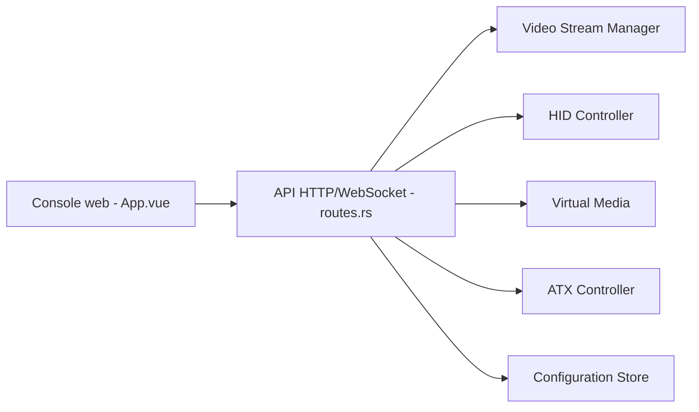

# mofeng-git/One-KVM

> Lightweight IP-KVM solution in Rust to remotely control a server or workstation, down to the BIOS.

## The problem
Troubleshooting a machine with no running system requires physical access to a screen, keyboard and power.

## What it actually does
A Rust binary with a web interface: video capture (USB HDMI, MIPI CSI, RK3588), MJPEG or WebRTC streaming (H.264, H.265, VP8, VP9), hardware or software encoding, keyboard and mouse via USB OTG or CH340/CH9329, virtual media (ISO, Ventoy), ATX power control through GPIO or USB relay, Opus audio. The code also describes a Redfish API and a "computer use" module. The README is in Chinese.

## How it is wired


## Trying it
```bash
sudo apt update
sudo apt install ./one-kvm_0.x.x_<arch>.deb
docker run --name one-kvm -itd \
  --privileged=true --restart unless-stopped \
  -v /dev:/dev -v /sys:/sys \
  --net=host \
  silentwind0/one-kvm-full
```

## Cost and gotchas
Specific capture and control hardware is required. The container runs in privileged mode with `/dev` and `/sys` mounted and host networking: isolate it. Detailed documentation is on an external site.

## What it is not
Not remote desktop software: it acts at the hardware level. The Python version is abandoned, replaced by the Rust version.

## Alternatives
No alternative named in the README; the old Python version is cited as abandoned.

## For you
Ignore unless you manage a fleet of physical machines (homelab, GPU) to troubleshoot remotely: outside the data/AI scope.
