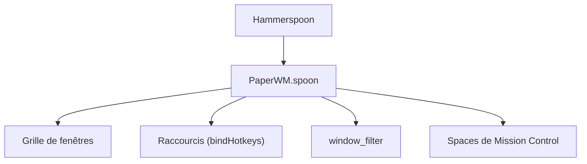

# mogenson/PaperWM.spoon

> Horizontally scrolling macOS window manager, built as a Hammerspoon Spoon.

## The problem
macOS has no tiling window manager, and multitasking with Spaces forces a lot of mouse handling.

## What it actually does
A Lua plugin for Hammerspoon that arranges windows in scrolling columns, inspired by PaperWM. It offers keyboard shortcuts, accordion-stacked columns, trackpad scrolling, mouse dragging, moving between Spaces and application filters. Everything is configured in Lua.

## How it is wired
Simplified diagram based on the card, no diagram provided.



## Trying it
```bash
git clone https://github.com/mogenson/PaperWM.spoon ~/.hammerspoon/Spoons/PaperWM.spoon
```
```lua
PaperWM = hs.loadSpoon("PaperWM")
PaperWM:bindHotkeys(PaperWM.default_hotkeys)
PaperWM:start()
```

## Cost and gotchas
Free. It requires adjusting Mission Control (uncheck automatic rearrangement of Spaces). macOS prevents moving a window entirely off screen.

## What it is not
It is not a Linux or Windows tool. It does not detect windows dragged from one Space to another well.

## Alternatives
No alternative named in the README.

## For you
Ignore for a data / AI / MLOps profile: a macOS workstation comfort, unrelated to your work.
