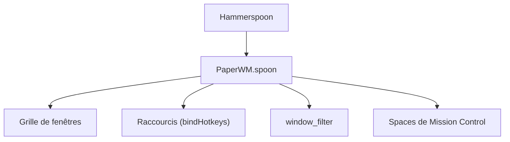

# mogenson/PaperWM.spoon

> Gestionnaire de fenêtres macOS à défilement horizontal, sous forme de Spoon Hammerspoon.

## Le problème
macOS ne propose pas de gestionnaire de fenêtres en tuiles, et le multitâche par Spaces oblige à beaucoup de manipulations à la souris.

## Ce que ça fait vraiment
Un plugin Lua pour Hammerspoon qui range les fenêtres en colonnes défilantes, inspiré de PaperWM. Il offre raccourcis clavier, colonnes empilées en accordéon, défilement au trackpad, glisser à la souris, déplacement entre Spaces et filtres d'applications. Tout se règle en Lua.

## Comment c'est branché
Schéma simplifié d'après la fiche, sans diagramme fourni.



## Essayer
```bash
git clone https://github.com/mogenson/PaperWM.spoon ~/.hammerspoon/Spoons/PaperWM.spoon
```
```lua
PaperWM = hs.loadSpoon("PaperWM")
PaperWM:bindHotkeys(PaperWM.default_hotkeys)
PaperWM:start()
```

## Coût et pièges
Gratuit. Il demande de régler Mission Control (décocher le réarrangement automatique des Spaces). macOS empêche de sortir une fenêtre entièrement de l'écran.

## Ce que ce n'est pas
Ce n'est pas un outil Linux ni Windows. Il ne détecte pas bien les fenêtres glissées d'un Space à un autre.

## Alternatives
Aucune alternative nommée dans le README.

## Pour toi
À ignorer pour un profil data / IA / MLOps : un confort de poste de travail macOS, sans lien avec ton métier.

