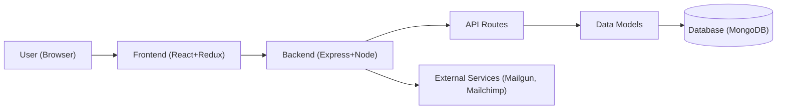

# mohamedsamara/mern-ecommerce

> MERN online shop with three roles (buyer, merchant, admin), for learning or bootstrapping a web project.

## The problem
Building a complete shop (catalog, cart, orders, merchant management) from scratch takes weeks, even with a familiar stack.

## What it actually does
A React/Redux client and an Express/Mongoose (MongoDB) server. Three journeys: the buyer browses categories, products, brands; the merchant manages their brand; the admin runs everything. Email services (Mailchimp, Mailgun) and a socket layer are present according to the code. A seed script creates the admin.

## How it is wired


## Trying it
```bash
git clone https://github.com/mohamedsamara/mern-ecommerce.git
# éditer docker-compose.yml : MONGO_URI et JWT_SECRET
docker-compose build
docker-compose up
npm run seed:db [email] [password]
npm run dev
```

## Cost and gotchas
Free, but you need a MongoDB database, client and server `.env` files, and third-party accounts (Mailchimp/Mailgun) for emails. Last push in August 2024.

## What it is not
Not a continuously maintained e-commerce platform: payments and compliance are not detailed in the README. A reference demo, not a product.

## Alternatives
No alternative named in the README.

## For you
Ignore: general full-stack web with no link to data or MLOps, and it has not moved in over a year.
