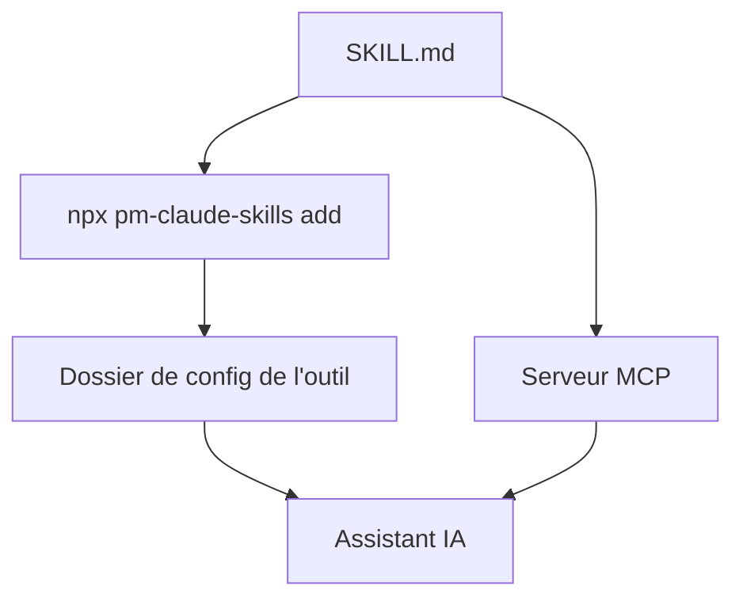

# mohitagw15856/pm-claude-skills

> Library of 1,314 markdown skills for AI assistants, centered on the product manager role.

## The problem
An AI assistant gives average answers on professional tasks (PRD, status update, decision) for lack of a framework and an output template.

## What it actually does
Each skill is a `SKILL.md` file with a trigger description, a working framework, an output template, quality checks and anti-patterns. An installer copies them into the tool's config folder (Claude, Cursor, Codex...). A read-only MCP server and REST API exist, as well as 153 thematic bundles.

## How it is wired
Simplified diagram based on the sheet, no diagram provided.


## Trying it
```bash
npx pm-claude-skills add
npx pm-claude-skills doctor
claude mcp add pm-skills -- npx -y -p pm-claude-skills pm-claude-skills-mcp
```

## Cost and gotchas
Free, but your prompts go to the model provider you choose. Telemetry is off by default. None of the 161 high-stakes skills has been reviewed by a professional, and the Duet skills have not been tested.

## What it is not
It is not professional advice: the README says so. It is not a program, only text read by your assistant.

## Alternatives
No alternative named in the README.

## For you
Worth watching: a sample of skills can serve as a template, but the volume and the lack of expert review mean you must read each skill before use.
