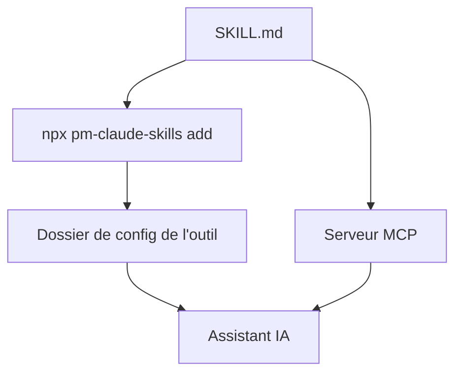

# mohitagw15856/pm-claude-skills

> Bibliothèque de 1 314 skills en markdown pour assistants IA, centrée sur le métier de chef de produit.

## Le problème
Un assistant IA donne des réponses moyennes sur des tâches pro (PRD, point d'étape, décision) faute de cadre et de modèle de sortie.

## Ce que ça fait vraiment
Chaque skill est un fichier `SKILL.md` avec description de déclenchement, cadre de travail, modèle de sortie, contrôles qualité et anti-motifs. Un installateur les copie dans le dossier de config de l'outil (Claude, Cursor, Codex...). Un serveur MCP et une API REST en lecture seule existent, ainsi que 153 lots thématiques.

## Comment c'est branché
Schéma simplifié d'après la fiche, sans diagramme fourni.


## Essayer
```bash
npx pm-claude-skills add
npx pm-claude-skills doctor
claude mcp add pm-skills -- npx -y -p pm-claude-skills pm-claude-skills-mcp
```

## Coût et pièges
Gratuit, mais tes prompts partent chez le fournisseur de modèle choisi. Télémétrie désactivée par défaut. Aucun des 161 skills à enjeux élevés n'a été relu par un professionnel, et les skills Duet n'ont pas été testés.

## Ce que ce n'est pas
Ce n'est pas un conseil professionnel : le README le dit. Ce n'est pas un programme, seulement du texte lu par ton assistant.

## Alternatives
Aucune alternative nommée dans le README.

## Pour toi
À surveiller : un échantillon de skills peut servir de modèle, mais la masse et l'absence de relecture experte imposent de lire chaque skill avant usage.

